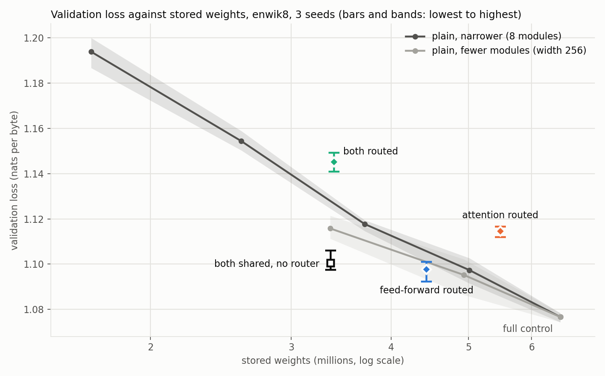

# weightbank

Does routing into a shared bank of weights beat a smaller plain model that stores the same
number of weights?

A transformer language model has M compute modules, and normally each owns its weights. Here
the model instead holds a bank of N < M weight chunks, and each module picks, for every input
token, one chunk from the bank to compute with. Stored weights shrink because N < M. Memory is
the resource treated as scarce; compute is not.

## Result



At equal stored weights, routing did not beat a smaller plain model after 8,000 training steps
on enwik8. Routing only the feed-forward weights matched the plain curve (0.003 nats per byte
below it, inside seed spread); routing attention, or both, landed 0.026 and 0.030 above it.
Sharing the same two banks with no router, each module fixed to one chunk, landed 0.015 below
the plain curve.

The full write-up, with every run, is in [report.md](report.md).

## Design

- **Model.** A pre-norm, decoder-only transformer over bytes: 8 modules, width 256, 4 heads,
  256 bytes of context. A module is one layer: an attention step and a feed-forward step.
- **Bank.** A feed-forward chunk is the two linear maps of one feed-forward step. An attention
  chunk is the query/key/value map and the output map of one attention step. A routed model
  stores 4 chunks of the routed kind for its 8 modules.
- **Router.** One small network per routed kind, shared by all modules. It sees the token's
  normalised hidden state and a learned vector for the module that is asking, and scores the
  chunks: `score(tanh(data(x) + asker[module]))`.
- **Hard picks.** Every forward pass uses exactly one chunk per token per module. Training
  samples the pick with Gumbel noise and passes gradients straight through the softmax;
  evaluation takes the highest score with no noise.
- **Attention with per-token picks.** Each token writes its key and value once, under its own
  chunk, and queries read whatever keys are there (mixed keys). That is how inference with a
  single key/value cache runs, and it is what is trained.
- **Private weights.** Each module keeps its own two layer norms; they count as stored
  weights, as do the routers, embeddings and output head.
- **Controls.** The full unshared model; plain models narrowed to widths 128 to 224 and plain
  models cut to 4 and 6 modules, which draw loss against stored weights; the routed code
  path with N = M and every module forced to its own chunk, which must match the full model;
  and both banks shared with no router, module i always using chunk i mod 4.
- **Data.** [enwik8](https://mattmahoney.net/dc/textdata.html), the first 100 MB of an English
  Wikipedia dump (text under CC BY-SA 3.0 / GFDL): 90 MB to train, the next 5 MB to validate.

## Run

The environment is pinned in `shell.nix` (PyTorch with CUDA); enter it with `nix-shell`.

```sh
python -m weightbank.train both-routed --seed 0   # one run, written to runs/both-routed-s0.json
python -m weightbank.sweep                         # every run that runs/ lacks
python -m weightbank.report                        # report.md and chart.png from runs/
python -m pytest && python -m mypy                 # tests and type check
```

Configurations are named in `weightbank/configs.py`: `full`, `plain-w128` to `plain-w224`,
`plain-l4`, `plain-l6`, `ff-routed`, `attn-routed`, `both-routed`, `own-chunk`,
`both-no-router`. The first run downloads enwik8 into `data/`. The reported runs, in `runs/`,
were trained on one RTX 2080, 8 GB.

## License

Licensed under either of [Apache License, Version 2.0](LICENSE-APACHE) or
[MIT license](LICENSE-MIT) at your option.
