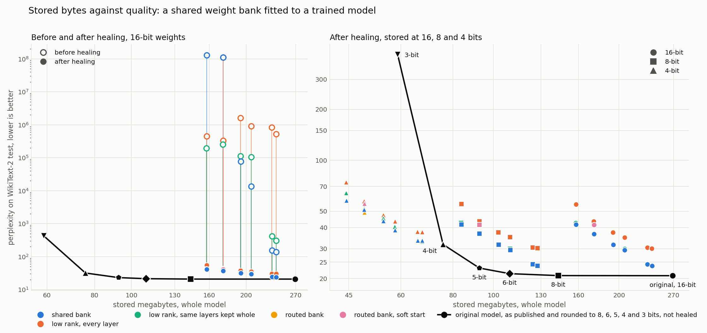
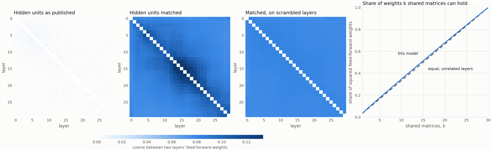

# Fitting a shared weight bank to a trained model

The aim of this project is an improvement other people can adopt in their own models. The
[first report](report.md) trains small models from scratch with a shared bank. This one is a
second, cheaper track beside it: take a published, already-trained language model, replace its
30 feed-forward steps with a bank of fewer shared ones, and ask what that costs in quality per
stored byte against the things people already do to shrink a model. An arm below is one
compressed model; healing is a brief fine-tune of the compressed weights to match the
original model's outputs.

Every table below is written by `python -m weightbank.compress` from the files in
`runs/compress/`. Quality is perplexity on the WikiText-2 test split; lower is better.

## Reading

1. Sharing did not pay for itself on this model. Rounding the original's weights to 5 bits
   cuts it from 269 to 93 MB at perplexity 23.1 (from 20.8), while the best bank arm reaches
   only 240 MB at 23.8; every bank arm at 16 or 8 bits is beaten by plain rounding at fewer
   bytes.
2. The bank does beat low rank on every layer, with 15 to 24% lower perplexity at equal
   bytes, but nearly all of that comes from leaving some layers whole: against a control that
   keeps the same layers whole and shares nothing, sharing is worth 0 to 2%. A per-input
   router over the bank, tried at one size, added nothing.
3. This model's layers have almost nothing in common to share: cosine 0.0007 as published,
   and 0.089 with hidden units matched against 0.079 for scrambled layers. This is a negative
   result for retrofitting a bank onto weights trained apart, and says nothing against a
   bank a model is trained with from the start.



Left: every arm before healing (hollow) and after (filled), at 16-bit weights, labelled by
bank size/rank; the weights-only fit alone leaves perplexity between 140 and 1.3 x 10^8, and healing
recovers most of it. Right: the healed arms stored at 16, 8 and 4 bits, with the original model rounded to
8, 6, 5, 4 and 3 bits as the black line. Arms that land on the same point are drawn as rings:
the shared bank is the small blue mark, and it sits inside the green same-layers control at
most sizes and inside the yellow routed bank at 8/64.

## What a negative result here does not show

This experiment asks whether weights that were trained to be separate can be folded together
afterwards. The layers of this model were never asked to share anything, and the measurement
below finds that they do not. A model trained from scratch with a shared bank can arrange its
layers so that sharing fits, which is what the fixed map in the [first report](report.md)
does, at a lower loss than a plain model of the same stored size. So a loss here is a
statement about retrofitting one trained model. It is not a verdict on shared weight banks.

## Setup

**Model.** [SmolLM2-135M](https://huggingface.co/HuggingFaceTB/SmolLM2-135M): 30 layers, width
576, 134.5 million weights, published as 16-bit floats (269 MB). It was chosen because its
Apache-2.0 licence allows redistributing derived weights, it downloads without a sign-in as a
safetensors file, it has 30 same-shaped layers to share among, and it is small enough to
fine-tune on one 8 GB GPU. Its feed-forward steps hold 59% of its weights, attention 20%, the
token embedding 21%.

**Bank.** One feed-forward step is three matrices (gate, up, down; 2.65 million weights). A
bank of N < 30 steps replaces the 30; each layer is assigned one bank step and, if it shares
that step with another layer, keeps a rank-r correction added to each of the three matrices.
A layer alone on its bank step is stored whole and gets no correction. Attention, norms and
the embedding are untouched.

**Fit, weights only.** The hidden units of a feed-forward step can be reordered without
changing what it computes, so two layers are compared, and later averaged, with their units
matched: the one-to-one pairing that maximises the inner product of their weights. Layers are
grouped by average-linkage clustering of their pairwise similarity after matching, then each
group alternates between its bank step (the mean of its members less
their corrections) and the corrections (the best rank-r matrix for what the bank step leaves),
minimising squared weight error.

**Healing.** The bank steps and corrections are then trained for {steps} steps of 4 x 512
tokens to match the original model's next-token distribution (KL divergence) on WikiText-103
training text; everything else stays frozen. The learning rate is chosen per kind of arm by
500-step runs on one bank size, scored on the WikiText-2 validation split.

**Controls at equal stored bytes.** *Low rank, every layer*: no sharing, every feed-forward
matrix replaced by its best low-rank matrix at the one rank that stores what the bank arm
stores. *Low rank, same layers kept whole*: the layers the bank stores whole stay whole, and
every layer that shares a bank step is instead low-rank at the rank that spends that step's
bytes on its members separately. The second control differs from the bank only in the
sharing. Both are healed exactly as the bank is.

**Quantization.** Round to nearest on a uniform grid over every run of 64 consecutive weights,
with the run's lowest and highest weight kept as 16-bit floats: 8.5 and 4.5 bits per weight.
It is applied to every matrix of the model, the embedding included, with no calibration data,
and to the healed arms after healing with no further training.

The original is also rounded to 6, 5 and 3 bits, to fill in the line the arms are judged
against and to show where rounding alone stops working.

**Stored bytes** count every weight of the whole model once, at 16 bits or at the quantized
width. The table of which layer uses which bank step (30 bytes) is not counted.

{original}

## How similar the layers are before any fit



The three squares compare every pair of the 30 layers (a layer with itself is left blank).

{similarity}

Before any fit, the layers of this model have nothing to share. With hidden units in the
order published, the cosine between two layers' feed-forward weights averages 0.0007 and never
exceeds 0.006; the four attention matrices are no closer (at most 0.021). The order of a layer's hidden units is
arbitrary, so the fair comparison first matches each layer's units to the other's (the
assignment that maximises their inner product). That lifts the mean to 0.089, but the same
matching applied to scrambled layers (every column's values shuffled among the hidden units,
so each layer keeps its values and loses any relation to the others) already gives 0.079: most of the similarity is made by the matching. What is left is a
band of neighbouring layers in the middle of the model, at most 0.133 between two layers. The
right panel says the same thing without choosing an order: the best k shared matrices can
hold barely more of the 30 layers' weights than k/30, the line for layers of equal size with
nothing in common. Sharing can therefore remove almost no weight error here that dropping
weights would not, and whatever the bank arms recover comes from healing.

## Every arm

Arms are named by bank size and correction rank; a control carries the name of the bank arm
whose bytes it matches. Weight error is squared error over the feed-forward weights as a share
of their squared size, before healing.

{arms}

## Sharing against the controls

Perplexity after healing at 16-bit weights.

{versus}

Against low rank on every layer the bank is ahead at every size, with 15 to 24% lower
perplexity at equal bytes. Almost all of that is the layout and not the sharing: the bank's
grouping leaves 3, 9 or 20 layers whole and concentrates the damage in the rest, and a model
that keeps the same layers whole and spends the same bytes on separate low-rank layers lands
within 2.2% of the bank at every size. What sharing itself adds is that last column: between
nothing and 2%.

**Stacked with quantization.** Rounding a healed arm to 8 bits costs it nothing, as it costs
the original nothing. At 4 bits the healed arms lose 24 to 51% of perplexity where the
original loses 53%. No arm at 4 bits is better than the original at 4 bits (31.8 at 76 MB),
but the stacked arms are the only models measured below the 4-bit original's 75.7 MB that
still work: the bank at
23/64 and 4 bits is 67.5 MB at 33.6, at 15/64 it is 58.1 MB at 38.6, while the original
rounded to 3 bits is 58.9 MB at 421.6. That comparison flatters the stacked arms, which were
healed, against a 3-bit original that was not; a calibrated 3-bit quantizer would be the fair
opponent and was not run. At 4 bits the same-layers control's perplexity runs from 2% below the
bank's to 11% above it, and that of low rank on every layer is 9 to 29% above it.

Three seeds of the {sweep_bank} arms (the seed sets the healing batches):

{seeds}

At this size the bank's 2% over the same-layers control is outside the seed spread: the
bank's three seeds span 0.13 of perplexity, the control's 0.09, and the means differ by 0.61.
The other five sizes have one seed each.

Which layers share:

{assignment}

## The routed variant

The routed variant was run at 8 bank steps and rank 64. A router, the score router of the first report, picks one of the 8 bank steps for
every token at every layer; each layer keeps its corrections. A per-layer prior starts every
layer on the bank step the fit assigned it, so before healing the routed model is exactly the
shared bank with its fixed assignment. It is healed the same way and at the same learning rate, sampling picks in
training and taking the highest score in evaluation. The router adds 0.08 MB.

Two starts were run. With a strong prior (8 added to the assigned step's score, so a sampled
pick leaves the assignment about once in 400) the router never moves: after healing, under one pick in a million is off the
fixed assignment and perplexity is 36.98 against the shared bank's 36.75. With a soft prior
(2, so training samples other bank steps about half the time) healing is worse, 41.53, and
the router ends back on the assignment, with 0.1% of picks off it. Both runs end with the router on
the fixed assignment, and sampling other bank steps on the way there costs perplexity. That
agrees with the first report, where a per-token pick lost to the fixed map on the same banks.

{routed}

## What changed from the plan, and why

- **Hidden units are matched before sharing.** The first design fitted the bank to the
  weights as published. The similarity measurement showed those have nothing in common (cosine 0.0007),
  and that a feed-forward step's hidden units can be reordered freely without changing what it
  computes. Each layer's units are therefore reordered to line up with its bank step. It
  lowers the fit's weight error at every size, by 5 to 7%:

{unmatched}

- **A layer alone on its bank step gets no correction.** Its bank step is the layer itself, so
  a correction would store bytes that reconstruct nothing.
- **A second control.** The first design had one control, low rank on every layer. The bank turned out
  to beat it mostly by leaving some layers whole, which is not sharing, so the same-layers
  control was added to separate the two.
- **Layer groups come from the similarity measurement** (clustering) and not from a search
  over assignments. Every group it found is a run of neighbouring layers.
- **The quantized arms use plain rounding** written here, so that the same code quantizes the
  original and every healed arm and the bytes are counted the same way.
- **A second routed run with a softer start**, described in its section.

Learning rates tried, perplexity on the validation split after 500 steps, the chosen rate in
bold:

{sweep}

## Prior work

Sharing weights across layers is old when it is trained in: ALBERT (Lan et al., 2019) shares
one set of weights across all layers, and Takase and Kiyono (2021) assign N sets to M layers
in fixed patterns; the first report's fixed map is their cycle pattern. Deep Compression (Han
et al., 2015) shares scalar weight values by clustering, not matrices across layers.

Retrofitting sharing onto a trained model, which is what this report does, has been done at
larger scale. DeltaLLM (Mikaelyan et al., 2025) makes later blocks reuse an earlier block's
weights plus low-rank deltas and trains the deltas by distillation; it reports about 12% fewer
parameters at about 90% of base performance. Verma, Murray and Duh (2025, "Merging
Feed-Forward Sublayers for Compressed Transformers") match hidden units by permutation, then
merge and tie feed-forward steps of trained models. Basis Sharing (Wang et al., 2024) shares
an SVD basis across adjacent layers with per-layer coefficients and reports better perplexity
than per-layer SVD at 20 to 50% compression of LLaMA-7B, while leaving out the feed-forward
down matrix and the attention output matrix because sharing them raised error. MASA (Zhussip et al., 2025) and LISA (Mu et al.,
2024) share attention weights across layers. Matching hidden units by permutation comes from
model merging (Git Re-Basin, Ainsworth et al., 2022). Low rank alone is SVD-LLM (Wang et al.,
2024) and ASVD (Yuan et al., 2023), both of which weight the error by activations, which the
controls here do not. Stronger quantizers than the rounding used here exist (GPTQ, Frantar et
al., 2022). Gromov et al. (2024) remove whole layers and heal, finding late layers the most
expendable.

What this report adds to that is small: the same idea on a 135-million-weight model with a
weights-only start, a measurement of how little the layers have in common, and a control that
separates sharing from the choice of which layers to leave whole, which the retrofitting
papers above do not report. It does not add a better method. Its finding, that the gain
credited to sharing is mostly a gain from uneven treatment of layers, is from one small model.

## Limits

- One model, and a small one. The papers above report sharing working on models of billions
  of weights.
- One evaluation, perplexity on WikiText-2, with healing on text from the same source
  (WikiText-103). The healed arms may have adapted to that text in a way the unhealed
  quantized original could not, which favours the healed arms.
- Healing is short ({steps} steps, about 4 million tokens) with the learning rate annealed to
  zero. A longer budget was not tried and could reorder arms that are close.
- The learning rate was chosen once per kind of arm, at 500 steps on the {sweep_bank} size,
  and used for every size at {steps} steps. The routed arms use the shared bank's rate
  and were run at one size.
- One seed everywhere except the {sweep_bank} size.
- The fit minimises weight error with no data. Activation-weighted fits, as in SVD-LLM, would
  help both the bank and the low-rank controls.
- The quantization baseline is rounding with no calibration; a stronger quantizer would lower
  the black line.
- Only the feed-forward steps are banked. Attention matrices were measured (they are as
  unrelated as the feed-forward ones) but not shared.
- Stored bytes are the measure. Speed and memory at run time were not measured; the low-rank
  corrections add work per token and the routed arm computes several bank steps in training.

## Reproduce

```sh
nix-shell --run 'python -m weightbank.compress'
```

It needs Nix (`shell.nix` pins the environment), a CUDA GPU (the runs here used one with 8 GB)
and about 430 MB of downloads, which go into `data/compress/` and are checked against pinned SHA-256 sums. It runs
every arm that `runs/compress/` lacks and rewrites this report and its two charts. With
`runs/compress/` as committed it only rewrites the report; delete that directory to run
everything again, about six and a half hours of healing on one RTX 2080.
