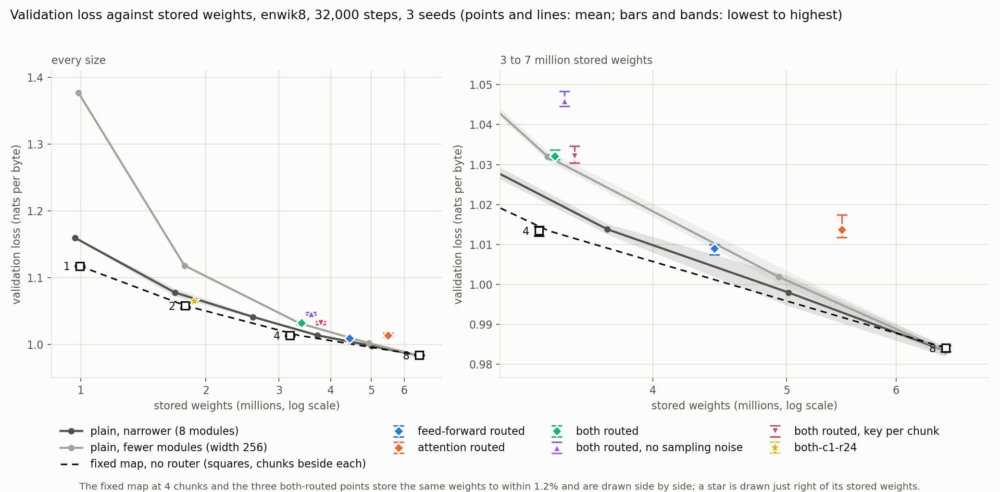

# Routing into a shared weight bank against smaller plain models

Every table below is written by `python -m weightbank.report` from the run files in `runs/`.
Loss is cross-entropy on the validation split in nats per byte (divide by 0.693 for bits).

Two experiments are reported together. The first trained every configuration for 8,000 steps
at one learning rate (1e-3), three seeds. The second asks which of the first's gaps belong to
the designs and which to a short or mis-tuned comparison: every configuration gets a learning
rate chosen for it by sweeps, then three seeds at four times the budget (32,000 steps). The
second also adds configurations, trained at both budgets: two other routers for the model
with both banks routed, the fixed module-to-chunk map with no router at 1 and 2 chunks beside
the first experiment's 4 and 8, and the plain models they are compared with.
A gap is a configuration's mean validation loss minus the better of the two plain curves read
at its stored weights; negative means the configuration beats a plain model of its size.

## Reading

Three findings of the first experiment held in sign and shrank in size: attention routed
stays above the plain curve (+0.026 at the first budget, +0.021 at the long one), both routed
stays above it (+0.030, now +0.012), and the fixed map with no router stays below it (-0.015,
now -0.008) and still beats both routed on the same banks, by 0.019 where it was 0.045. One
moved: feed-forward routed went from -0.003, inside the seed spread, to +0.005 with all three
seeds above the curve (+0.003 to +0.008), so at the long budget it is slightly worse than a
plain model of its size and no longer level with it; part of that is the plain curve, since
at tuned rates the narrowed plain model became the better curve, and against the curve of
fewer modules, the better one at the first budget, feed-forward routed sits at -0.001. The
signs of those three are therefore properties of the designs, while both routed lost three fifths of its
gap, the fixed map half and attention routed a fifth to the longer budget and tuned rates:
choosing a chunk per token costs loss against a plain model and against fixed sharing of the
same weights, and fixed sharing is the only arrangement here that beats a plain model of
equal storage.



The chart is the long budget, whole on the left and enlarged between 3 and 7 million stored
weights on the right. The dark line is the plain model narrowed from width 256 to 96 at 8
modules; the lighter line is the plain model cut from 8 modules to 1 at width 256. Bands and
bars run from the lowest to the highest of three seeds. The dashed line joins the fixed
module-to-chunk map with no router at 1, 2, 4 and 8 chunks. The fixed map at 4 chunks and the
three models with both banks routed store the same weights to within 1.2%; their four points
are drawn side by side so that none hides another, which the chart notes under its panels.
Points are means of three seeds. A star is a cell with three seeds at this budget beyond
those of the first two experiments, so far the one the loop described next has tried; it is
drawn just right of its stored weights so that it hides no point of equal size.

## The design space and the loop

This section is generated from [ledger.json](ledger.json), the record of the design space:
its axes, every cell tried with the run files behind it, the hypotheses, and each round the
loop has run. The sections after it write up the two experiments that came before the loop. A cell is one value
on every axis. A cell's name is the tags of its values that differ from the default, in the
order of the axes, and `full` when none does; the training budget is the directory the run
file sits in. Learning rate and seed are not axes. A cell at the first budget is run at
three seeds at one rate and swept over three rates at seed 0; a cell at a longer budget gets
its rate from the sweep described under "Choosing the learning rate" and is then run at
three seeds at that rate.

### Axes

{{axes}}

Adding an axis or a value is one edit to the ledger's `axes`. Names, the cells a hypothesis
may name, the loop and the tables here follow from it; cells already tried sit at the new
axis's default. The model has to know the value: a cell naming one it cannot build is
refused. With nothing shared, `pick`, `chunks` and `rank` stay at their defaults.

### Hypotheses

A hypothesis claims that one cell reaches a lower validation loss than another, and lists
the comparisons that would settle it. A comparison is finished when each of its cells has
three seeds at one learning rate, its own. It favours the hypothesis when the lower cell is
below the higher one at every seed and the mean difference exceeds both cells' seed spread
(standard deviation), and goes against it when the lower cell is above by the same test. A
hypothesis is `supported` when all its comparisons are finished and favour it, `refuted`
when all go against it, and `open` otherwise; one with no comparison stays open and is
never picked. A lower priority number is run first. Priorities and hypotheses are edited by
hand in the ledger; statuses are computed.

{{hypotheses}}

### How a round picks its cell

`python -m weightbank.loop --gpu-hours H` runs one round:

1. Take the open hypotheses that have an unfinished comparison, lowest priority number
   first, ledger order among equals.
2. Cost each unfinished comparison: the steps its two cells still lack under the run
   protocol of "Choosing the learning rate" (three runs at the first budget, at least two
   at the cell's own budget to choose the rate, then the other two seeds), at the seconds
   per step of the tried cell that differs on the fewest axes, the slowest among ties.
3. Pick the first hypothesis with a comparison costing at most H GPU-hours, and its
   cheapest such comparison. Hypotheses passed over, as too costly or for a rate sweep that
   cannot go on, are named in the round.
4. Train what the two cells lack, one run at a time; a cell that already has its three
   seeds costs nothing. Then rewrite the ledger's cells and statuses from the run files, and
   this report and chart from the ledger.

The estimate is a floor, since a rate sweep that lands on the edge of its grid adds runs.
With no hypothesis to pick the loop trains nothing. A comparison whose runs end without
three finite seeds is marked abandoned in the ledger and not picked again.

### Rounds

{{rounds}}

### Every cell

One row per cell and budget, from the run files; the rate, mean and seed spread are filled
where three seeds share a rate.

{{cells}}

## The gaps at both budgets

Each plain curve is read at the configuration's stored weights by interpolating mean loss
linearly in the logarithm of stored weights, and the gap is taken to whichever curve is lower
there. Seeds share batches across configurations, so the gap is also computed seed by seed
(the configuration at seed s against that same curve drawn from the plain runs of seed s);
the range of those three is beside each mean. At the long budget seed 0 is also the seed the
learning rates were chosen on, so each seed-0 loss is the lowest of the rates tried; the
column without seed 0 is the gap over the two seeds that took no part in the choice.

{{both-budgets}}

Between the two budgets both the learning rate and the number of steps change. The next
table changes the rate alone: the first budget, seed 0 only, with every configuration at 1e-3
and then at the best of the three rates tried for it at that budget (the short sweep below),
both read against the plain curve the first-budget gap above uses. Each loss on the
right-hand side is the lowest of three, and a one-seed gap carries about a seed spread of
noise (0.002 to 0.009 in the per-configuration table); it can show a shift of the size of
the attention-routed and both-routed gaps and not one of the size of the feed-forward routed
gap.

{{rate-alone}}

The plain curves the gaps are read against, at both budgets:

{{plain}}

### Long budget, both plain curves

{{gaps-long}}

### First budget, both plain curves

{{gaps-first}}

`both-routed` and `plain-l4` are an equal-storage pair that needs no interpolation: the same 4
feed-forward and 4 attention chunks, applied 8 times with routing or 4 times without. The
routed model adds 38,536 weights (two routers and four more modules' layer norms).

## Choosing the learning rate

The rate is chosen in two stages, each one seed (seed 0), and the choice is made at the
budget it is used at. The warm-up (200 steps) and the cosine decay to a tenth of the peak are
the same at every rate and budget.

Short sweep: 8,000 steps at peak rates 5e-4, 1e-3 and 2e-3. The 1e-3 run is the first
experiment's seed-0 run. Lowest loss in bold; the last column is how far the next-best rate
is behind it.

{{short-sweep}}

Every configuration's best short rate is 2e-3, the highest of the three, by 0.005 to 0.036
over 1e-3: a short budget rewards a high rate. A rate chosen here would therefore say more
about the budget than about the configuration, which is why the short sweep only names where
the long sweep starts, and why the first experiment's single rate of 1e-3 was low for every
configuration at once.

Long sweep: 32,000 steps at the best short rate and the better of its neighbours in the
short sweep. The rate with the lowest long loss is the configuration's rate, and its run is
the configuration's seed-0 long run; seeds 1 and 2 are then trained at that rate. A winner on
the edge of the rates tried gets the next rate a factor of two beyond it added, and the rule
is applied again, in two cases: when the winner is not the best short rate (the long budget
moved the optimum, so that side is followed until a tried rate lies beyond the winner), and
when it leads the next-best rate by more than 0.005. A run whose training loss stops being
finite is recorded with an infinite loss and loses.

{{long-sweep}}

Limits of this choice: it is made on one seed, so where two rates differ by less than the
seed spread the pick between them is arbitrary; and a winner that is the best short rate
and leads by 0.005 or less has no rate tried beyond it, so a rate beyond it could be better
by a similar amount. The feed-forward routed gap is of that size at both budgets.

## What was cut

- The long sweep starts from two rates per configuration and adds more only under the rule
  above. Six configurations ended with two long rates; a third for each would have added
  about three hours of the GPU.
- `both-c8` has no sweep of its own: it is the full control computed through the bank code,
  so it trains at the full control's rate, which keeps the two paired.
- The two other routers were run for the model with both banks routed only. Feed-forward-only
  and attention-only versions of them would be four more configurations, about 21 hours of
  the GPU, and the both-routed pair already answers what they were added to ask.
- No configuration was trained under another optimizer: a check under Muon would need its own
  rate sweeps and long runs and was left out.

## Setup

- Data: enwik8, the first 100 MB of an English Wikipedia dump (text under CC BY-SA 3.0 and
  GFDL). Bytes are the tokens (vocabulary 256). The first 90 MB train, the next 5 MB validate;
  validation loss is over all 19,531 non-overlapping 256-byte windows of that split.
- Model: pre-norm decoder-only transformer, 8 modules, width 256, 4 heads, context 256,
  learned positions. A module is one layer: an attention step and a feed-forward step.
- Budget: 8,000 steps of 64 windows in the first experiment and 32,000 in the second, AdamW
  (peak rate 1e-3 in the first experiment and the chosen rate in the second, 200 warm-up
  steps, cosine decay to a tenth of the peak over the run, weight decay 0.1 on matrices and
  embeddings), mixed precision (float16 autocast), gradient clipping at 1. Seeds 0, 1, 2 set
  both the initial weights and the batches.
- Bank: 4 chunks of each routed kind for 8 modules. A feed-forward chunk is both linear maps
  of a feed-forward step; an attention chunk is the query/key/value map and the output map.
- Router: one per routed kind, shared by all modules, 64 units wide. It scores the chunks from
  the token's normalised hidden state plus a learned vector for the asking module:
  `score(tanh(data(x) + asker[module]))`, where `score` is a linear map to one score per
  chunk.
- Key-per-chunk router (`both-routed-keys`): each chunk has a learned key of 64 numbers; the
  score of a chunk is the dot product of its key with a query, `query(x + asker[module])`, a
  linear map of the token's normalised hidden state plus the asking module's vector. It
  differs from the router above in having no nonlinearity and no per-chunk bias and in adding
  the module's vector before the linear map. Keys start at the scale of the other router's
  scoring weights, so both start equally close to indifferent. The pick is trained the same
  way.
- Noise-free router (`both-routed-argmax`): the router above, but training takes the
  highest-scoring chunk with no Gumbel noise; the gradient still flows through the softmax.
- Fixed map (`both-c1`, `both-c2`, `both`, `both-c8`): no
  router; module i always computes with chunk i mod N, for N = 1, 2, 4, 8 chunks of each kind.
  Every module keeps its own layer norms, as in every other configuration. The equal-storage
  plain partner of N chunks is the plain model of N modules (`plain-l1`, `plain-l2`,
  `plain-l4`, `full`); the fixed map stores (8 - N) x 1,024 more weights than its partner,
  the layer norms of the extra modules.
- Training the hard pick: straight-through Gumbel-softmax at temperature 1. The forward pass
  always computes with exactly one chunk per token per module, sampled with Gumbel noise, and
  the gradient flows through the softmax. This was chosen over a soft mixture annealed to a
  hard one because the network trained is the network evaluated from the first step: no
  schedule, and no gap between soft training and hard inference to close. Validation takes the
  highest-scoring chunk without noise.
- Attention with per-token picks: mixed keys. A token computes its query, key, value and
  output projection under its own chunk; a query reads keys and values that other tokens wrote
  under theirs. Inference with one key/value cache runs exactly this way, and training runs
  the same computation. Recomputing keys under the querying token's chunk would need one
  cache per chunk, spending the memory the bank saves.
- Private weights: each module keeps its own two layer norms (1,024 weights per module). No
  other per-module add-on. Stored weights count every parameter: bank chunks, routers and
  their module vectors, layer norms, embeddings and the output head.
- Hardware: one RTX 2080, 8 GB, shared with other work, so wall times are indicative: a
  run slowed or paused by other work on the GPU counts that time. Runs
  were trained one at a time. During
  training a routed step computes every chunk for every token (the straight-through gradient
  needs them), which is why routed runs take longer; a hard pick needs only the picked chunk
  at inference, which this code does not exploit. `both-c8` and `both` pay a
  bookkeeping cost per chunk that `full` does not, so their times are not comparable to it.

## Sanity check: N = M, every module forced to its own chunk

`both-c8` runs the routed code path with a bank of 8 chunks of each kind and no router:
module i always computes with chunk i. It starts from the same initial weights and sees the
same batches as `full` at the same seed, so the comparison is paired by seed. First budget:

{{sanity-first}}

Long budget, both at the full control's rate:

{{sanity-long}}

At the first budget the per-seed differences (+0.0004, -0.0001, +0.0000) are a fifth or less
of the full control's seed sd (0.0021). At the long budget they are +0.0025, +0.0004 and
-0.0005, mean +0.0008, against a seed sd of 0.0012: the two start from the same weights and
compute the same function in a different order of operations, and over 32,000 steps of
half-precision arithmetic their trajectories drift apart by about as much as two seeds do.
The routed code path with N = M reproduces the full control at both budgets.

## Why did the fixed map beat the learned router?

In the first experiment `both`, the same two banks with module i fixed to chunk
i mod 4, beat `both-routed` by 0.045. Two things separate them besides the choice itself: the
routed model trains under sampling noise (every pick is drawn with Gumbel noise), and its
router has one particular form. `both-routed-argmax` removes the noise and
`both-routed-keys` changes the form. All four store the same banks; at the same seed they
see the same batches. Long budget, each at its chosen rate:

{{routers-long}}

First budget, every one at 1e-3:

{{routers-first}}

Neither the sampling noise nor the router's form explains it. Removing the noise made the
model worse at both budgets: `both-routed-argmax` is 0.014 above `both-routed` at the long
budget (1.0459 against 1.0322, every seed) and 0.013 above it at the first, and its router
ends far less decided (it gives its pick a probability of 0.51 to 0.56, where the two sampled
both-routed models give 0.85 to 0.96), so the noise was helping the router commit and not costing loss.
Changing the form changed nothing: `both-routed-keys` ends at 1.0321, within 0.0001 of
`both-routed`, and at the first budget it is 0.005 above it, inside its own seed sd of 0.009.
All three routed models stay 0.019 to 0.033 above the fixed map at the long budget (0.045 to
0.058 at the first). What separates the routed models from the fixed map is therefore
something these two arms leave in place: every module choosing among all four chunks token by
token, trained through a hard pick. The longer budget and tuned rates closed three fifths of
the distance (0.045 to 0.019) without either change to the router.

## Reuse without a router, by number of chunks

The fixed map at 4 chunks is cycle sharing in the sense of Takase and Kiyono (2021, "Lessons
on Parameter Sharing across Layers in Transformers", arXiv:2104.06022): a stack of N layers
applied repeatedly. At 1 chunk it is ALBERT-style sharing (Lan et al., 2020, "ALBERT: A Lite
BERT for Self-supervised Learning of Language Representations"): one layer applied 8 times.
At 8 chunks it is the full control. Unlike both, every module here keeps its own layer norms.
Each is set beside the plain model of as many modules as
it has chunks, which stores the same chunks and applies each once, and beside the plain
curve at its stored weights.

{{fixed-map}}

The gain from reuse grows as the chunks get fewer. Against the plain model that stores the
same chunks and applies each once, 8 modules reusing them are better by 0.260 at 1 chunk,
0.060 at 2 and 0.019 at 4 at the long budget (0.221, 0.039 and 0.015 at the first), and
level at 8, where nothing is reused; that comparison mostly measures depth, 8 applications
against N. Against the better plain model of equal storage, which may be wide and deep, the
fixed map still wins at every size below the full model, by 0.038 at 1 chunk, 0.015 at 2 and
0.008 at 4 at the long budget (0.053, 0.039 and 0.015 at the first): ALBERT-style sharing
gives the largest gain per stored weight and cycle sharing at 4 chunks the smallest, and the
longer budget widened the gain over the partner while narrowing the gain over the plain
curve, because tuned narrow plain models improved the most. The 2-chunk figure is the least
certain: its seeds range from -0.023 to -0.005 against the curve, and its rate was chosen by
a margin of 0.0004.

## Picks at validation against picks in training

Training samples each pick with Gumbel noise; the reported loss takes the highest-scoring
chunk. If the routers had not committed, the two would differ widely. Mean over seeds, long
budget:

{{sampled}}

## During training

Long budget: mean over seeds of validation loss on the first {{log-windows}} validation
windows, to show whether the ordering at the end of the budget was still moving.

{{during-training}}

## How much picks vary by input

Measured on the validation split with the picks inference makes. For each module, the share
of tokens whose pick is not that module's most common pick says how much the pick depends on
the input: 0 means the module always picks the same chunk, 0.75 is the most four chunks
allow. The table gives the mean of that share over modules and seeds, its lowest value in any
module of any seed, and the mean probability the router's softmax gives the chunk it picks
(0.25 is indifference, 1 is certainty), at both budgets.

{{pick-variation}}

The tables below are the long budget in full. The first column of numbers has one entry per
module, first module to last: the share of tokens off that module's most common pick. The
next has the router's mean probability for its pick. The usage columns pool all modules;
evenness is the entropy of usage divided by its maximum (1 is even).

### Feed-forward routed

{{picks:ff-routed}}

### Attention routed

{{picks:attn-routed}}

### Both routed

{{picks:both-routed}}

### Both routed, no sampling noise

{{picks:both-routed-argmax}}

### Both routed, key per chunk

{{picks:both-routed-keys}}

## Per configuration

Long budget:

{{summary-long}}

First budget:

{{summary-first}}

## Every run

Both experiments and the learning-rate sweep, from the run files.

{{runs}}

## Reproducing

`nix-shell` gives the environment. One command reproduces any run in the table above:

```sh
python -m weightbank.train <configuration> --seed <seed> --steps <steps> --rate <learning rate>
```

It writes `runs/<steps>/<configuration>-lr<learning rate>-s<seed>.json`.
A configuration's name is its cell's name in the ledger. `python -m weightbank.loop
--gpu-hours <hours>` picks and trains the next cell, and `python -m weightbank.report`
rebuilds this file and the chart.
