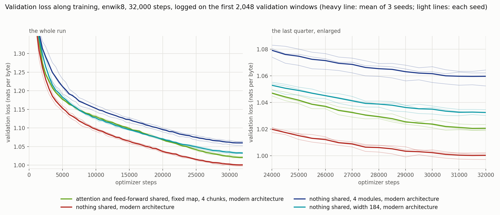
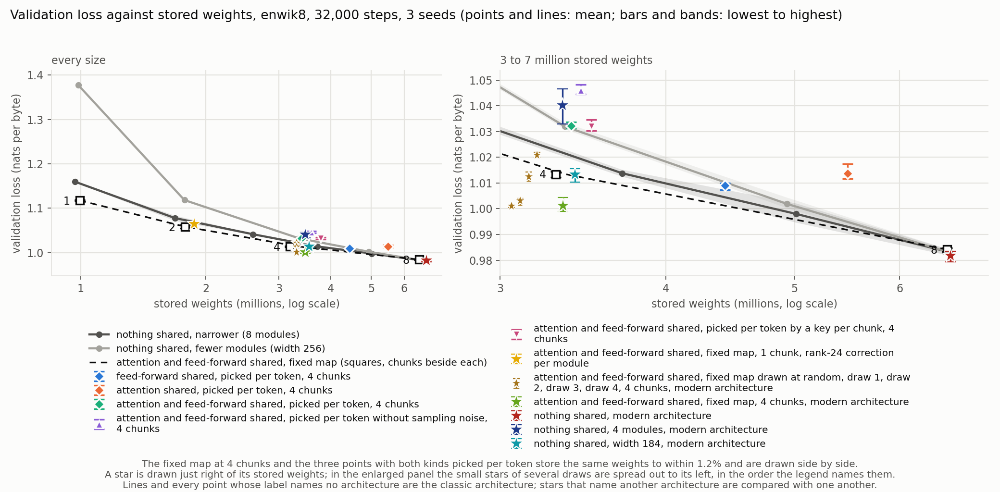

# Routing into a shared weight bank against smaller plain models

Every table below is written by `python -m weightbank.report` from the run files in `runs/`.
Loss is cross-entropy on the validation split in nats per byte (divide by 0.693 for bits).

Two experiments are reported together. The first trained every configuration for 8,000 steps
at one learning rate (1e-3), three seeds. The second asks which of the first's gaps belong to
the designs and which to a short or mis-tuned comparison: every configuration gets a learning
rate chosen for it by sweeps, then three seeds at four times the budget (32,000 steps). The
second also adds configurations, trained at both budgets: two other routers for the model
with both banks routed, the fixed module-to-chunk map with no router at 1 and 2 chunks beside
the first experiment's 4 and 8, and the plain models they are compared with.
A gap is a configuration's mean validation loss minus the better of the two plain curves read
at its stored weights; negative means the configuration beats a plain model of its size.

## How a run ends

A run ends after a fixed number of optimizer steps, 8,000 or 32,000, set before it starts.
Nothing watches the validation loss: no run stops early for having learned enough, and none
is trained until its loss stops falling. The one exception is a run whose training loss
stops being a finite number, which is ended and recorded as lost. The learning rate climbs for 200 steps and then follows a cosine down to a tenth of
its peak, which it reaches at the last step. The loss reported for a run is the validation
loss of the weights as they stand after that last step, over the whole validation split; no
earlier or best checkpoint is kept.

No run here is converged. The table sets each cell stopped at 8,000 steps (seed 0, the best
of the three rates tried) beside the same cell stopped at 32,000 (seed 0), and gives how far
the logged loss moved over the last 2,000 and the last 500 steps of the long run, averaged
over its three seeds. Four times the steps bought 0.064 to 0.089 at
every cell. Over the last 2,000 steps of the long run, by which point the rate is within a
tenth of its floor, the loss still falls by 0.002 to 0.004; over the last 500 it moves by
less than 0.001 in either direction. The curve is flat at the last step because the
schedule has brought the rate to its floor there, not because the model has stopped
learning: a longer run would end lower. Every comparison in this report is therefore
between runs of equal steps, and none is between converged models. Whether the order of
the model that picks per token and the fixed map survives four times the steps again is an
open hypothesis in the ledger (`picking-too-few-steps`).

| cell | in plain words | seed 0, stopped at 8,000 steps, best of 3 rates | seed 0, stopped at 32,000 steps | what 4 times the steps bought | change over the last 2,000 of 32,000 steps, mean of seeds | change over the last 500 of 32,000 steps, mean of seeds |
|---|---|---|---|---|---|---|
| `both-modern` | attention and feed-forward shared, fixed map, 4 chunks, modern architecture | 1.0626 | 0.9989 | -0.0637 | -0.0032 | +0.0001 |
| `modern` | nothing shared, modern architecture | 1.0575 | 0.9835 | -0.0740 | -0.0020 | +0.0001 |
| `plain-l4-modern` | nothing shared, 4 modules, modern architecture | 1.1128 | 1.0414 | -0.0714 | -0.0019 | +0.0001 |
| `plain-w184-modern` | nothing shared, width 184, modern architecture | 1.0820 | 1.0104 | -0.0716 | -0.0025 | -0.0003 |
| `full` | nothing shared | 1.0538 | 0.9819 | -0.0719 | -0.0032 | -0.0003 |
| `both` | attention and feed-forward shared, fixed map, 4 chunks | 1.0802 | 1.0122 | -0.0681 | -0.0040 | -0.0009 |
| `both-routed` | attention and feed-forward shared, picked per token, 4 chunks | 1.1208 | 1.0316 | -0.0892 | -0.0036 | +0.0004 |



The curves are the four modern cells the reading leads with, logged every 500 steps on the
first 2,048 validation windows, which read about 0.02 above the loss over the whole split.
The plain model at full width is the lowest from about step 2,000 on and the plain model of
four modules the highest from step 1,000 on. The shared model starts below the plain model
narrowed to width 184, runs 0.002 to 0.005 above it from about step 8,000 to step 18,500,
crosses back between steps 19,000 and 20,000 and ends 0.012 below it. All four are flat
over the last 500 steps.

## Reading

The pair to judge sharing by holds compute equal. In the modern architecture, eight modules
at width 256 that each own their weights store 6,444,192 weights and reach 0.9819 nats per
byte at 32,000 steps. The same eight modules sharing four chunks through the fixed map store
3,289,936, 51% as many, and reach 1.0012. The two multiply by the same number of weights
per token, so the difference is what halving the stored weights costs at equal compute:
0.019 on average, and 0.015, 0.022 and 0.021 at the three seeds, where each model's seeds
have a standard deviation of 0.002 to 0.003. Sharing is not free. It is the cheapest of the
three ways tried here of storing half the weights: against the same full model, dropping to
four modules costs 0.058 and narrowing all eight to width 184 costs 0.031, and those two
also do about half the arithmetic per token, which sharing does not save. On the GPU the
shared model holds 13 MiB of weights against the full model's 25, and that is nearly all
it saves: a batch of 256 windows peaks at 508 MiB for one and 507 for the other, and a
training step at 1,879 and 1,916, where the 37 MiB between them are the gradient and
optimizer copies of the weights the shared model does not have (the table under "GPU
memory").

The fixed map is not new: sending module i to chunk i mod N is the cycle strategy of Takase
and Kiyono (2021, "Lessons on Parameter Sharing across Layers in Transformers",
arXiv:2104.06022), which stacks M layers with independent parameters and repeats them in
the same order, and which they present as relaxing the sharing of one layer's parameters
with all layers, as in Universal Transformers (Dehghani et al., arXiv:1807.03819). A
vendor's release page for a model of about 9 billion parameters, SenseNova Loop-9B,
describes reuse across layers at that scale, in a layout with ends of its own: by the
vendor's account it stores 32 decoder layers and computes 56, running the middle 24 twice
with the same weights and the first four and last four once. No number of theirs is checked here. A map with ends of its own is
in the ledger as an open hypothesis (`own-ends-beat-the-all-shared-map`).

Three findings of the first experiment held in sign and shrank in size: attention routed
stays above the plain curve (+0.026 at the first budget, +0.021 at the long one), both routed
stays above it (+0.030, now +0.012), and the fixed map with no router stays below it (-0.015,
now -0.008) and still beats both routed on the same banks, by 0.019 where it was 0.045. One
moved: feed-forward routed went from -0.003, inside the seed spread, to +0.005 with all three
seeds above the curve (+0.003 to +0.008), so at the long budget it is slightly worse than a
plain model of its size and no longer level with it; part of that is the plain curve, since
at tuned rates the narrowed plain model became the better curve, and against the curve of
fewer modules, the better one at the first budget, feed-forward routed sits at -0.001. The
signs of those three are therefore properties of the designs, while both routed lost three fifths of its
gap, the fixed map half and attention routed a fifth to the longer budget and tuned rates:
choosing a chunk per token costs loss against a plain model and against fixed sharing of the
same weights, and fixed sharing is the only arrangement here that beats a plain model of
equal storage.

The loop described below has since run eight rounds at the long budget; the cells they
tried are the stars on the chart. The fourth is the equal-compute pair above. Rounds 5
to 8 trained four fixed maps drawn at random beside the mod map, in the modern architecture
at equal stored weights: two are worse than the mod map at every seed, by 0.020 and 0.011,
and two are level with it (0.002 above and 0.0001 below on average), so at the mod map's
learning rate which module uses which chunk matters, by more than the training seed does,
and no drawn map is separated from the mod map on the better side (the section "Fixed maps"
has each map). A low-rank correction per module on one shared chunk does
not beat a second chunk at equal stored weights. Rounds 2 and 3 took the fixed map, eight
modules reusing four chunks with no router, into a modern transformer (rotary positions,
root-mean-square norms, a gated feed-forward) and set it against two plain models. The
shared model reaches 1.0012. Four modules that own the same four chunks reach 1.0403, which
is 0.039 above. The stronger control keeps all eight modules and is narrowed: at width 184
it reaches 1.0133, so the shared model is 0.012 below it on average and below it at every
seed, by 0.012, 0.010 and 0.015, where each model's seeds have a standard deviation of
0.003.

How equal stored weights was reached: with one width, not exactly. A width has to be a
multiple of 8, so that each of the four heads has an even number of dimensions to rotate in
pairs. Width 184 stores 2.1% more weights than the shared model and width 176 would store
6.4% fewer, so the control is the nearer of the two and the larger model. If a modern plain
model gains from width as the classic ones do, the margin at exactly equal stored weights is
a little above 0.012: on the classic narrower curve 2.1% of stored weights is worth 0.002.
No second modern width has been run to show that. In the classic architecture the shared
model of the same shape is 0.008 below the narrower plain curve at equal stored weights. So
the gain did not shrink in the modern design: 0.012 over a larger plain model, against 0.008
at equal stored weights in the classic one. One comparison in each architecture does not say
by how much the two gains differ.

That is the result nearest to something to adopt: in this small byte-level transformer with
the modern parts, a model limited by stored weights reaches a lower loss as eight modules
sharing four chunks than as either plain model of that storage that was run, four modules at
full width or eight modules narrowed. Round 2's 0.039 was measured against the weaker of the
two controls. The modern plain model of four modules reads 0.008 worse than the same cell in
the classic architecture, while the modern shared model and the modern narrowed model read
better than their classic counterparts, by 0.012 and 0.008 (the table under "The modern
cells beside the classic architecture"). Of the three modern plain cells run, then, one reads
worse than its classic counterpart, one reads better, against an interpolated classic curve
and not a run of its own width, and the full model reads level with it (0.001 lower, inside
its seed spread), so the plain model reading worse is not general to modern plain models
here. No run isolates why the cell of four modules reads
worse, and no cause is claimed. Against the control that does not read worse the margin is
0.012, under a third of 0.039.

What this does not show. It is one dataset of bytes, one size (3.3 million stored weights),
one bank size (four chunks for eight modules), one training budget and three seeds. The
modern plain control is one width and one depth: it is 2.1% larger than the shared model
instead of an interpolation between two widths, and no other mix of depth and width at that
storage, such as six narrower modules, has been run in the modern architecture. Learning
rates are chosen on seed 0, and the narrowed model's two best rates end 0.0003 apart in
loss. Against these two controls stored weights are held nearly equal and compute is not: the
shared model runs eight modules at width 256, which multiply by about 1.9 times the weights
per token of eight modules at width 184 and twice those of four modules at width 256; the
pair at the head of this reading is the one that holds compute equal and lets storage
differ. On this GPU a training step of the
shared model and of the narrowed one took the same time, about 110 ms. Whether a per-token
pick fares differently in the modern architecture has not been run.



The chart is the long budget, whole on the left and enlarged between 3 and 7 million stored
weights on the right. The dark line is the plain model narrowed from width 256 to 96 at 8
modules; the lighter line is the plain model cut from 8 modules to 1 at width 256. Bands and
bars run from the lowest to the highest of three seeds. The dashed line joins the fixed
module-to-chunk map with no router at 1, 2, 4 and 8 chunks. The fixed map at 4 chunks and the
three models with both banks routed store the same weights to within 1.2%; their four points
are drawn side by side so that none hides another, which the chart notes under its panels.
Points are means of three seeds. A star is a cell with three seeds at this budget beyond
those of the first two experiments, tried by the loop described next; it is drawn just
right of its stored weights so that it hides no point of equal size. The two lines and the
other points are the classic architecture; the four small stars are the maps drawn at
random, set just left of the shared modern model they are compared with, and the four large stars of the modern architecture are
read against one another, not against the lines: at about 3.3 million stored weights the
shared model lowest, the plain model narrowed to width 184 above it and the plain model of
four modules highest, and at 6.4 million the plain model of eight modules at full width,
below all three. The legend label of every point and
star is spelled from the plain words the ledger gives each axis value: what the cell
shares, the values it has off the default, and for a cell that shares weights also how a
module gets its chunk and how many chunks a bank holds. A line's label opens with the same
words for what its cells have in common.

## The design space and the loop

This section is generated from [ledger.json](ledger.json), the record of the design space:
its axes, every cell tried with the run files behind it, the hypotheses, and each round the
loop has run. The sections after it write up the two experiments that came before the loop. A cell is one value
on every axis. A cell's name is the tags of its values that differ from the default, in the
order of the axes, and `full` when none does; the training budget is the directory the run
file sits in. Learning rate and seed are not axes. A cell at the first budget is run at
three seeds at one rate and swept over three rates at seed 0; a cell at a longer budget gets
its rate from the sweep described under "Choosing the learning rate" and is then run at
three seeds at that rate.

### Axes

| axis | meaning | values (default in bold) | tags in a run's path |
|---|---|---|---|
| shared | which weights the modules draw from a bank instead of owning: none, feed-forward, attention or both | **none**, ff, attn, both | `ff`, `attn`, `both` |
| pick | how a module gets its chunk: fixed is module i to chunk i mod N; ends gives the first module and the last a chunk of their own and cycles the modules between them through the rest; drawn is a map drawn at random before training and kept for the whole run (each module's chunk is drawn uniformly, and the modules are drawn again together until every chunk is used); routed is a per-token learned pick sampled with noise; argmax the same without noise; keys scores a learned key per chunk; frozen is routed until a quarter of training, then each module keeps its most common pick; stopped is routed with the router's weights held still after that quarter | **fixed**, ends, drawn, routed, argmax, keys, frozen, stopped | `ends`, `drawn`, `routed`, `routed-argmax`, `routed-keys`, `frozen-picks`, `stopped-router` |
| draw | which map a drawn pick uses: the seed of the generator the map is drawn from, apart from the training seed, so one draw is one map at every training seed; 0 with any other pick | **0**, 1, 2, 3, 4 | `d1`, `d2`, `d3`, `d4` |
| chunks | bank size: chunks stored per shared kind | 1, 2, **4**, 8 | `c1`, `c2`, `c8` |
| rank | rank of a low-rank correction each module adds to the shared chunk it uses; 0 is none | **0**, 24 | `r24` |
| modules | compute modules (layers) | 1, 2, 4, 6, **8**, 16 | `plain-l1`, `plain-l2`, `plain-l4`, `plain-l6`, `l16` |
| width | hidden width | 96, 128, 160, 184, 192, 224, **256** | `plain-w96`, `plain-w128`, `plain-w160`, `plain-w184`, `plain-w192`, `plain-w224` |
| steps | training budget in optimizer steps; the tag is the directory under runs/ | **8000**, 32000, 128000 | `8000`, `32000`, `128000` |
| architecture | the transformer around the banks: classic is learned positions, layer norms and a GELU feed-forward; modern is rotary positions, root-mean-square norms and a gated feed-forward | **classic**, modern | `modern` |

Adding an axis or a value is one edit to the ledger's `axes`. Names, the cells a hypothesis
may name, the loop and the tables here follow from it; cells already tried sit at the new
axis's default. The model has to know the value: a cell naming one it cannot build is
refused. With nothing shared, `pick`, `chunks` and `rank` stay at their defaults.

### Hypotheses

A hypothesis claims that one cell reaches a lower validation loss than another, and lists
the comparisons that would settle it. A comparison is finished when each of its cells has
three seeds at one learning rate, its own. It favours the hypothesis when the lower cell is
below the higher one at every seed and the mean difference exceeds both cells' seed spread
(standard deviation), and goes against it when the lower cell is above by the same test. A
hypothesis is `supported` when all its comparisons are finished and favour it, `refuted`
when all go against it, and `open` otherwise; one with no comparison stays open and is
never picked. A lower priority number is run first. Priorities and hypotheses are edited by
hand in the ledger; statuses are computed.

| priority | hypothesis | statement | settling comparisons (lower minus higher, by seed) | status |
|---|---|---|---|---|
| 1 | low-rank-correction | A shared bank plus a low-rank correction per module beats plain sharing at equal stored weights: one chunk per bank with a rank-24 correction in each of the 8 modules reaches a lower loss than the fixed map with two chunks, which stores 2,304 more weights (0.1%). | `32000/both-c1-r24` below `32000/both-c2`: +0.0094, +0.0081, +0.0023 | **refuted** |
| 1 | halving-stored-weights-costs-loss-at-equal-compute | At equal compute in the modern architecture, halving the stored weights costs loss: the plain model of eight modules at width 256, which owns all eight chunks of each kind, reaches a lower loss than eight modules sharing four chunks through the fixed map. The two multiply by the same number of weights per token; the shared model stores 3,289,936 weights, 51% of the plain model's 6,444,192. Supported means sharing has a price at equal compute, and the differences are its size; refuted would mean the shared model reaches the lower loss with half the weights; open, that three seeds do not separate the two. | `32000/modern` below `32000/both-modern`: -0.0154, -0.0217, -0.0209 | **supported** |
| 2 | reuse-survives-the-modern-architecture | The gain from reuse survives the modern architecture: with rotary positions, root-mean-square norms and a gated feed-forward, eight modules reusing four chunks still beat the plain model of four modules. | `32000/both-modern` below `32000/plain-l4-modern`: -0.0425, -0.0422, -0.0326 | **supported** |
| 2 | sharing-beats-a-narrowed-modern-model | In the modern architecture the shared model beats a plain model that keeps all eight modules and stores no fewer weights: eight modules reusing four chunks through the fixed map reach a lower loss than the plain model narrowed to width 184, the width nearest to the shared model's stored weights among multiples of 8, which stores 70,088 more weights (2.1%). | `32000/both-modern` below `32000/plain-w184-modern`: -0.0115, -0.0097, -0.0152 | **supported** |
| 2 | the-mod-map-beats-a-map-drawn-at-random | Which module uses which chunk matters: in the modern architecture the mod map, where every chunk serves two modules four apart, reaches a lower loss than a fixed map drawn at random over the same four chunks. A drawn map uses every chunk, so it stores exactly the mod map's weights, and it trains at the mod map's learning rate. One comparison per drawn map: supported means every drawn map is worse, refuted that every one is better, and open that the maps do not all fall on one side by more than the spread of training seeds. | `32000/both-modern` below `32000/both-drawn-d1-modern`: -0.0210, -0.0175, -0.0203<br>`32000/both-modern` below `32000/both-drawn-d2-modern`: -0.0135, -0.0099, -0.0104<br>`32000/both-modern` below `32000/both-drawn-d3-modern`: -0.0051, +0.0030, -0.0033<br>`32000/both-modern` below `32000/both-drawn-d4-modern`: -0.0015, +0.0030, -0.0011 | **open** |
| 3 | picking-lock-in | A per-input pick loses to the fixed map because routers lock in early, near-random picks: with each module frozen to its router's most common pick after a quarter of training, the model still loses to the fixed map of module i to chunk i mod N. | `32000/both` below `32000/both-frozen-picks`: not run | **open** |
| 3 | picking-chase | A per-input pick loses because chunks and router chase each other: holding the router's weights still after a quarter of training beats letting it learn throughout. | `32000/both-stopped-router` below `32000/both-routed`: not run | **open** |
| 3 | picking-worse-function | A per-input pick loses because mixing chunks token by token is a worse function than one chunk per module, even under a router that no longer moves: frozen picks beat a stopped router. | `32000/both-frozen-picks` below `32000/both-stopped-router`: not run | **open** |
| 4 | own-ends-beat-the-all-shared-map | At equal stored weights, giving the first and the last module chunks of their own and looping the modules between them beats sharing every chunk alike: with four chunks for eight modules in the modern architecture, the map 0 1 2 1 2 1 2 3 reaches a lower loss than the mod map 0 1 2 3 0 1 2 3, which stores the same weights. | `32000/both-ends-modern` below `32000/both-modern`: not run | **open** |
| 4 | a-pick-freed-from-the-fixed-map-beats-a-pick-learned-from-the-start | A per-token pick that starts as the fixed map and is freed only once the chunks have specialised beats a pick learned from the first step: every module computes through the mod map for the first part of training, then a router initialised to reproduce that map takes over. A chunk has to be something stable before choosing among chunks can mean anything. No cell expresses this yet: it needs a pick value that hands over from the map to a router. Its cell would train at the routed model's pace, about 8 GPU-hours under the rate protocol. | no cell | **open** |
| 5 | picking-too-few-steps | A per-input pick loses only because training is short: at 128,000 steps the routed model reaches a lower loss than the fixed map. | `128000/both-routed` below `128000/both`: not run | **open** |
| 6 | compress-a-trained-model | A trained unshared model can be compressed into a shared bank and keep a lower loss than the same shared model trained from scratch. No cell expresses this yet: it needs an axis for how training starts. | no cell | **open** |
| 7 | the-map-matters-more-with-more-modules | With sixteen modules over the same four chunks, where a drawn map can differ from the mod map in more places than with eight, the mod map reaches a lower loss than a map drawn at random. Both cells store the weights of the eight-module shared model plus eight modules' norms, and compute twice as much per token. The loop prices the pair at 7.5 GPU-hours from the pace of eight modules; sixteen modules take about twice the time per step, so about 15. | `32000/both-l16-modern` below `32000/both-drawn-d1-l16-modern`: not run | **open** |
| 9 | reuse-beats-fewer-modules | Eight modules reusing N chunks beat the plain model of N modules, which stores the same chunks and applies each once. | `32000/both-c1` below `32000/plain-l1`: -0.2580, -0.2593, -0.2622<br>`32000/both-c2` below `32000/plain-l2`: -0.0634, -0.0611, -0.0555<br>`32000/both` below `32000/plain-l4`: -0.0195, -0.0198, -0.0164 | **supported** |
| 9 | routing-beats-the-fixed-map | A per-input pick over the two banks beats the fixed map over the same banks. | `32000/both-routed` below `32000/both`: +0.0194, +0.0200, +0.0167<br>`32000/both-routed-argmax` below `32000/both`: +0.0361, +0.0310, +0.0304<br>`32000/both-routed-keys` below `32000/both`: +0.0224, +0.0168, +0.0167 | **refuted** |

### How a round picks its cell

`python -m weightbank.loop --gpu-hours H` runs one round:

1. Take the open hypotheses that have an unfinished comparison, lowest priority number
   first, ledger order among equals.
2. Cost each unfinished comparison: the steps its two cells still lack under the run
   protocol of "Choosing the learning rate" (three runs at the first budget, at least two
   at the cell's own budget to choose the rate, then the other two seeds), at the seconds
   per step of the tried cell that differs on the fewest axes, the slowest among ties. A
   tried cell's seconds per step are those of its fastest run with a finite loss at any
   budget: a run that sat stopped or shared the card only gained time, so the fastest is the
   nearest to training alone.
3. Pick the first hypothesis with a comparison costing at most H GPU-hours, and its
   cheapest such comparison. Hypotheses passed over, as too costly or for a rate sweep that
   cannot go on, are named in the round.
4. Train what the two cells lack, one run at a time; a cell that already has its three
   seeds costs nothing. Then rewrite the ledger's cells and statuses from the run files, and
   this report and chart from the ledger.

The estimate is a floor, since a rate sweep that lands on the edge of its grid adds runs,
and it prices a new value of an axis at the pace of the old one. A run's training seconds
are summed over its 500-step log windows, each window at the median pace of itself and the
two windows on either side, which leaves out a stretch of up to two windows that the
process sat stopped while other work held the card, keeps a pace that changes during
training, and does not count the validation pass after each window. The runs before round 2 recorded
the wall time inside their training loop instead, stops included; their files keep those
seconds, and the estimate reads past them by taking each cell's fastest run.
With no hypothesis to pick the loop trains nothing. A comparison whose runs end without
three finite seeds is marked abandoned in the ledger and not picked again.

### Rounds

### Round 1: low-rank-correction

low-rank-correction (priority 1) is the highest-priority open hypothesis with an unfinished comparison that fits 12 GPU-hours; the cheapest is 32000/both-c1-r24 against 32000/both-c2, estimated at 2.5 GPU-hours.

32000/both-c1-r24 reached 1.0649 nats per byte with 1,780,736 stored weights at rate 0.002; 32000/both-c2 reached 1.0583 with 1,783,040 at rate 0.001. Lower minus higher by seed: +0.0094, +0.0081, +0.0023. low-rank-correction went from open to refuted.

8 runs, 4.8 GPU-hours of training against an estimate of 2.5; ledger rows written: `32000/both-c1-r24`, `8000/both-c1-r24`.

Read against one chunk without the correction, which reaches 1.1177 with 994,304 stored weights: the rank-24 correction recovers 0.0527 of the 0.0593 that a second chunk buys, for 2,304 fewer stored weights than the second chunk, and stops 0.0066 short of it. The GPU-hours are wall time inside the training loop, including stretches a run sat paused while other work used the card.

### Round 2: reuse-survives-the-modern-architecture

reuse-survives-the-modern-architecture (priority 2) is the highest-priority open hypothesis with an unfinished comparison that fits 12 GPU-hours; the cheapest is 32000/both-modern against 32000/plain-l4-modern, estimated at 3.3 GPU-hours.

32000/both-modern reached 1.0012 nats per byte with 3,289,936 stored weights at rate 0.002; 32000/plain-l4-modern reached 1.0403 with 3,287,888 at rate 0.001. Lower minus higher by seed: -0.0425, -0.0422, -0.0326. reuse-survives-the-modern-architecture went from open to supported.

15 runs, 7.4 GPU-hours of training against an estimate of 3.3; ledger rows written: `32000/both-modern`, `32000/plain-l4-modern`, `8000/both-modern`, `8000/plain-l4-modern`.

In plain words: in a transformer built the way current ones are, eight modules that reuse four chunks by a fixed map beat four modules that own the same four chunks, at stored weights 2,048 apart (0.06%) and at every seed. The gain is 0.0391, where the same pair in the classic architecture gains 0.0186 (1.0134 against 1.0320), so the benefit of reuse does not come from the older design. What the round does not show: whether the shared model beats a modern model narrowed to the same stored weights, the better plain control in the classic architecture, which has no modern runs; whether a per-token pick fares differently in the modern architecture; and anything at another size or on other data. The modern cells trained at about twice the seconds per step of the fastest classic runs of the same shape, which the estimate, priced from classic cells, did not foresee; one more run in the rate sweep of the plain model accounts for the rest of the 7.4 GPU-hours.

### Round 3: sharing-beats-a-narrowed-modern-model

sharing-beats-a-narrowed-modern-model (priority 2) is the highest-priority open hypothesis with an unfinished comparison that fits 12 GPU-hours; the cheapest is 32000/both-modern against 32000/plain-w184-modern, estimated at 4.6 GPU-hours.

32000/both-modern reached 1.0012 nats per byte with 3,289,936 stored weights at rate 0.002; 32000/plain-w184-modern reached 1.0133 with 3,360,024 at rate 0.001. Lower minus higher by seed: -0.0115, -0.0097, -0.0152. sharing-beats-a-narrowed-modern-model went from open to supported.

8 runs, 5.7 GPU-hours of training against an estimate of 4.6; ledger rows written: `32000/plain-w184-modern`, `8000/plain-w184-modern`.

In plain words: in a transformer built the way current ones are, eight modules sharing four chunks by a fixed map beat the plain model that keeps all eight modules and is narrowed to about the same stored weights, by 0.0121 on average and at every seed. Width 184 is the nearest width (a width is a multiple of 8, so that each of four heads rotates its dimensions in pairs) and stores 70,088 more weights than the shared model (2.1%), so the plain side is the larger; width 176 would store 6.4% fewer. If a modern plain model gains from width as the classic ones do, the margin at exactly equal stored weights is a little larger, which no second modern width has been run to show. This is the stronger of the two plain controls: round 2's margin over the plain model of four modules was 0.0391, and the narrowed control is 0.0270 below that one, which leaves 0.0121. The plain model of four modules reads 0.0083 worse in the modern architecture than in the classic one (1.0403 against 1.0320), while the shared model reads 0.0122 better (1.0012 against 1.0134) and the narrowed model 0.0081 better than the classic narrower curve at its stored weights (1.0133 against 1.0214). So of the two modern plain cells run, one reads worse than its classic counterpart and one better; no run isolates why. In the classic architecture the shared model is 0.0080 below the narrower curve at equal stored weights. What the round does not show: a modern plain curve (the control is one width, 2.1% larger, not an interpolation); another mix of depth and width at that storage; another size, bank size, budget or dataset; a per-token pick in the modern architecture; and compute, which is not held equal: the shared model runs eight modules at width 256, which multiply by about 1.9 times the weights per token of the narrowed model, though a training step took the same time for both, about 110 ms. The long budget moved the narrowed model's best rate from 0.002 to 0.001, by 0.0003 in loss, so the rate sweep added a run at 0.0005; that run is 1.0 of the 1.1 GPU-hours over the estimate, and the rest is pace, 111 ms a step against the 108 of the tried cell the estimate priced it from.

### Round 4: halving-stored-weights-costs-loss-at-equal-compute

halving-stored-weights-costs-loss-at-equal-compute (priority 1) is the highest-priority open hypothesis with an unfinished comparison that fits 12 GPU-hours; the cheapest is 32000/modern against 32000/both-modern, estimated at 4.6 GPU-hours.

32000/modern reached 0.9819 nats per byte with 6,444,192 stored weights at rate 0.001; 32000/both-modern reached 1.0012 with 3,289,936 at rate 0.002. Lower minus higher by seed: -0.0154, -0.0217, -0.0209. halving-stored-weights-costs-loss-at-equal-compute went from open to supported.

7 runs, 4.3 GPU-hours of training against an estimate of 4.6; ledger rows written: `32000/modern`, `8000/modern`.

In plain words: this is the pair to judge sharing by when compute is what is held equal. Both models run eight modules at width 256 and multiply by the same number of weights per token; the plain one owns all eight chunks of each kind and stores 6,444,192 weights, the shared one reuses four and stores 3,289,936, 51% as many. The plain model reaches 0.9819 and the shared one 1.0012, so halving the stored weights costs 0.0193 nats per byte on average, at every seed (0.0154, 0.0217, 0.0209), where each model's seeds have a standard deviation of 0.002 to 0.003. The price is small beside what the same halving costs a plain model that gives up modules or width: four modules at width 256 reach 1.0403, 0.0584 above the full plain model, and eight modules at width 184 reach 1.0133, 0.0314 above it. What the round does not show: the same pair at another size, bank size, budget or dataset, or the classic pair under one protocol (there the full model reads 0.9833 and the shared one 1.0134, 0.0301 apart). The plain model's best rate is 0.001 and the shared model's 0.002, each chosen on seed 0; the plain model at 0.002 reads 0.9852 at seed 0, 0.0017 above its run at 0.001.

### Round 5: the-mod-map-beats-a-map-drawn-at-random

the-mod-map-beats-a-map-drawn-at-random (priority 2) is the highest-priority open hypothesis with an unfinished comparison that fits 12 GPU-hours; the cheapest is 32000/both-modern against 32000/both-drawn-d1-modern, estimated at 2.9 GPU-hours.

32000/both-modern reached 1.0012 nats per byte with 3,289,936 stored weights at rate 0.002; 32000/both-drawn-d1-modern reached 1.0208 with 3,289,936 at rate 0.002. Lower minus higher by seed: -0.0210, -0.0175, -0.0203. No status changed.

3 runs, 2.8 GPU-hours of training against an estimate of 2.9; ledger rows written: `32000/both-drawn-d1-modern`.

A drawn map is fixed for the whole run and the same at every training seed: each of the eight modules' chunks is drawn uniformly from a generator seeded with the draw's number alone, apart from the training seed, and a draw that leaves a chunk unused is thrown away whole and drawn again, so every map uses all four chunks and stores exactly the mod map's 3,289,936 weights; an unused chunk never has to be counted. It trains at the mod map's learning rate, 0.002, with no sweep of its own. Draw 1 is the map 0 1 1 2 2 2 3 1, numbering chunks in order of first use; it is worse than the mod map (0 1 2 3 0 1 2 3) at every seed, by 0.0196 on average: 1.0208 against 1.0012.

### Round 6: the-mod-map-beats-a-map-drawn-at-random

the-mod-map-beats-a-map-drawn-at-random (priority 2) is the highest-priority open hypothesis with an unfinished comparison that fits 12 GPU-hours; the cheapest is 32000/both-modern against 32000/both-drawn-d2-modern, estimated at 2.8 GPU-hours.

32000/both-modern reached 1.0012 nats per byte with 3,289,936 stored weights at rate 0.002; 32000/both-drawn-d2-modern reached 1.0125 with 3,289,936 at rate 0.002. Lower minus higher by seed: -0.0135, -0.0099, -0.0104. No status changed.

3 runs, 2.9 GPU-hours of training against an estimate of 2.8; ledger rows written: `32000/both-drawn-d2-modern`.

A drawn map is fixed for the whole run and the same at every training seed: each of the eight modules' chunks is drawn uniformly from a generator seeded with the draw's number alone, apart from the training seed, and a draw that leaves a chunk unused is thrown away whole and drawn again, so every map uses all four chunks and stores exactly the mod map's 3,289,936 weights; an unused chunk never has to be counted. It trains at the mod map's learning rate, 0.002, with no sweep of its own. Draw 2 is the map 0 0 1 1 0 2 2 3, numbering chunks in order of first use; it is worse than the mod map at every seed, by 0.0113 on average: 1.0125 against 1.0012.

### Round 7: the-mod-map-beats-a-map-drawn-at-random

the-mod-map-beats-a-map-drawn-at-random (priority 2) is the highest-priority open hypothesis with an unfinished comparison that fits 12 GPU-hours; the cheapest is 32000/both-modern against 32000/both-drawn-d3-modern, estimated at 2.8 GPU-hours.

32000/both-modern reached 1.0012 nats per byte with 3,289,936 stored weights at rate 0.002; 32000/both-drawn-d3-modern reached 1.0030 with 3,289,936 at rate 0.002. Lower minus higher by seed: -0.0051, +0.0030, -0.0033. No status changed.

3 runs, 3 GPU-hours of training against an estimate of 2.8; ledger rows written: `32000/both-drawn-d3-modern`.

A drawn map is fixed for the whole run and the same at every training seed: each of the eight modules' chunks is drawn uniformly from a generator seeded with the draw's number alone, apart from the training seed, and a draw that leaves a chunk unused is thrown away whole and drawn again, so every map uses all four chunks and stores exactly the mod map's 3,289,936 weights; an unused chunk never has to be counted. It trains at the mod map's learning rate, 0.002, with no sweep of its own. Draw 3 is the map 0 1 2 1 1 0 0 3, numbering chunks in order of first use; it is level with the mod map: 1.0030 against 1.0012, 0.0018 above on average with one seed of three below, inside the mod map's seed spread of 0.0029.

### Round 8: the-mod-map-beats-a-map-drawn-at-random

the-mod-map-beats-a-map-drawn-at-random (priority 2) is the highest-priority open hypothesis with an unfinished comparison that fits 12 GPU-hours; the cheapest is 32000/both-modern against 32000/both-drawn-d4-modern, estimated at 2.8 GPU-hours.

32000/both-modern reached 1.0012 nats per byte with 3,289,936 stored weights at rate 0.002; 32000/both-drawn-d4-modern reached 1.0011 with 3,289,936 at rate 0.002. Lower minus higher by seed: -0.0015, +0.0030, -0.0011. No status changed.

3 runs, 3 GPU-hours of training against an estimate of 2.8; ledger rows written: `32000/both-drawn-d4-modern`.

A drawn map is fixed for the whole run and the same at every training seed: each of the eight modules' chunks is drawn uniformly from a generator seeded with the draw's number alone, apart from the training seed, and a draw that leaves a chunk unused is thrown away whole and drawn again, so every map uses all four chunks and stores exactly the mod map's 3,289,936 weights; an unused chunk never has to be counted. It trains at the mod map's learning rate, 0.002, with no sweep of its own. Draw 4 is the map 0 1 2 3 1 1 1 0, numbering chunks in order of first use; it is level with the mod map: 1.0011 against 1.0012, with one seed of three below. With this round all four drawn maps have run, so five distinct maps have been trained, the mod map among them. In plain words: which module uses which chunk matters, and by more than the training seed does. The five maps' mean losses run from 1.0011 to 1.0208, a standard deviation across maps of 0.0087, where the three training seeds of one map have a standard deviation of 0.0015 on average (0.0006 to 0.0029). The hypothesis stays open by its own rule, because two of the four drawn maps are not separated from the mod map: two are worse at every seed and two are level, each below it at seed 1 alone. The two that lose each put three pairs of neighbouring modules on one chunk and the two that are level put two; the mod map puts none. Four draws do not separate that from how unevenly a map loads its chunks, or from which modules share with the first and the last, or from the learning rate, which was chosen for the mod map and used for every map. What the rounds do not show: more than four draws, another bank size, more modules over the same bank (an open hypothesis in the ledger), or a map chosen on purpose.

### The modern cells beside the classic architecture

Each cell of the modern architecture that has three seeds at the long budget, beside the
same cell in the classic architecture where that cell has runs. A plain model narrowed in
width alone that has no classic twin is set beside the classic narrower plain curve read at
its stored weights, interpolated seed by seed as the gaps below are. One cell does not store
the same weights in both architectures: the modern one has no position table, its norms have
no bias, and its feed-forward hidden width is rounded down. Each cell is at its own chosen
learning rate.

| cell | stored weights | mean loss | classic counterpart | its stored weights | its mean loss | cell minus classic, by seed | mean |
|---|---|---|---|---|---|---|---|
| `32000/both-drawn-d1-modern` | 3,289,936 | 1.0208 | none with runs |  |  |  |  |
| `32000/both-drawn-d2-modern` | 3,289,936 | 1.0125 | none with runs |  |  |  |  |
| `32000/both-drawn-d3-modern` | 3,289,936 | 1.0030 | none with runs |  |  |  |  |
| `32000/both-drawn-d4-modern` | 3,289,936 | 1.0011 | none with runs |  |  |  |  |
| `32000/both-modern` | 3,289,936 | 1.0012 | `32000/both` | 3,360,512 | 1.0134 | -0.0133, -0.0092, -0.0142 | -0.0122 |
| `32000/modern` | 6,444,192 | 0.9819 | `32000/full` | 6,515,456 | 0.9833 | +0.0016, -0.0016, -0.0043 | -0.0014 |
| `32000/plain-l4-modern` | 3,287,888 | 1.0403 | `32000/plain-l4` | 3,356,416 | 1.0320 | +0.0097, +0.0132, +0.0020 | +0.0083 |
| `32000/plain-w184-modern` | 3,360,024 | 1.0133 | the narrower plain curve, read at the same stored weights | 3,360,024 | 1.0214 | -0.0097, -0.0088, -0.0058 | -0.0081 |

In the modern architecture the shared model reads 0.012 lower than its classic counterpart
and the narrowed plain model 0.008 lower, the full plain model reads level with its own
(0.001 lower, with seeds on both sides), and the plain model of four modules reads 0.008
higher. That cell is above its classic twin at every seed, by 0.002 to 0.013, and its seeds
have a standard deviation of 0.007, the widest of the four modern cells. The two plain
cells that move differ in depth and width at once (four modules at width 256, eight at width 184), and
no run varies one without the other or changes one part of the modern design at a time, so
the table shows where the modern plain model reads worse and not why. What it changes is the
size of the gain from sharing: the shared model's margin over the plain model of four
modules, 0.039, is about three times its margin over the narrowed one, 0.012.

### GPU memory

Peak memory held by PyTorch's allocator on the GPU while a cell runs, measured by
`python -m weightbank.memory` on freshly initialised weights and random bytes: the weights
alone as 32-bit floats; one forward pass at inference over 1 window of 256 bytes and over
the 256 windows of a validation batch, with nothing kept for gradients; and three training
steps of 64 windows, with the gradients and the optimizer's two moments per weight. Every
peak includes the weights. It is the allocator's peak and not the process total, which adds
the CUDA context, the same for every cell, and it leaves out the 95 MiB
of text a training run also keeps on the GPU.

| cell | in plain words | stored weights | weights alone, MiB | inference, 1 window, MiB | inference, 256 windows, MiB | training, 64 windows, MiB |
|---|---|---|---|---|---|---|
| `both-modern` | attention and feed-forward shared, fixed map, 4 chunks, modern architecture | 3,289,936 | 13 | 20 | 508 | 1,879 |
| `modern` | nothing shared, modern architecture | 6,444,192 | 25 | 38 | 507 | 1,916 |
| `plain-l4-modern` | nothing shared, 4 modules, modern architecture | 3,287,888 | 13 | 20 | 488 | 1,013 |
| `plain-w184-modern` | nothing shared, width 184, modern architecture | 3,360,024 | 13 | 23 | 989 | 1,966 |

At inference the shared model saves the weights it does not store and nothing else. Its weights take 13
MiB against the full plain model's 25. A pass over one window peaks 8 MiB above the weights
for the shared model and 14 MiB above them for the plain one; a 16-bit copy of the weights
would take 6 and 12 of those, and the pass runs as validation does, under 16-bit autocast
over 32-bit weights. Over 256 windows the activations are
nearly all of the peak and the two models are level, at 508 and 507 MiB. In training the
plain model's 37 MiB more is three further copies of its 12 MiB of extra weights, a
gradient and two optimizer moments. The plain model of four modules computes half as much
and trains in about half the memory. The model narrowed to width 184 peaks at 989 MiB over
256 windows, more than the full-width model. A one-off probe of plain modern models of
eight modules at seven widths, measured the same way and not kept in `runs/memory.json`,
peaks at 309, 373, 440 and 507 MiB at widths 160, 192, 224 and 256, whose four heads each
have a multiple of 8 dimensions, and at 968, 989 and 1,027 MiB at widths 176, 184 and 200,
whose heads do not. The probe shows where the larger peak falls and not what causes it.

### Fixed maps: the mod map, maps drawn at random, and own ends

A fixed map says which chunk each module computes with, for the whole run and for every
token. The mod map sends module i to chunk i mod N. The map with own ends gives the first
module and the last a chunk each that no other module uses and cycles the modules between
them through the remaining chunks: 0 1 2 1 2 1 2 3 for eight modules over four chunks. A drawn map is drawn before training
from a random generator seeded with the draw's number alone, so one draw is one map at
every training seed, and the training seed still sets the initial weights and the batches.
Each module's chunk is drawn uniformly and independently; a draw that leaves a chunk unused
is thrown away whole and drawn again, so a drawn map always uses the whole bank and stores
exactly the weights of the mod map. An unused chunk therefore never arises and never has to
be counted: a map that left one out would be a smaller bank, which the `chunks` axis
already covers. A drawn map may put neighbouring modules on one chunk and may load the
chunks unevenly. Which chunk is called 0 means nothing, so the table numbers each map's
chunks in order of first use; two draws that give the same row are the same map. A map
other than the mod map trains at the mod map's learning rate, so that the map is the only
thing that differs.

| cell | chunk of each module, first to last | modules on each chunk | neighbouring modules on one chunk | seed 0 | seed 1 | seed 2 | mean | seed sd | minus the mod map, by seed | mean difference |
|---|---|---|---|---|---|---|---|---|---|---|
| `32000/both-modern` | 0 1 2 3 0 1 2 3 | 2 2 2 2 | 0 | 0.9989 | 1.0044 | 1.0003 | 1.0012 | 0.0029 |  |  |
| `32000/both-drawn-d1-modern` | 0 1 1 2 2 2 3 1 | 1 3 3 1 | 3 | 1.0199 | 1.0219 | 1.0206 | 1.0208 | 0.0010 | +0.0210, +0.0175, +0.0203 | +0.0196 |
| `32000/both-drawn-d2-modern` | 0 0 1 1 0 2 2 3 | 3 2 2 1 | 3 | 1.0124 | 1.0143 | 1.0107 | 1.0125 | 0.0018 | +0.0135, +0.0099, +0.0104 | +0.0113 |
| `32000/both-drawn-d3-modern` | 0 1 2 1 1 0 0 3 | 3 3 1 1 | 2 | 1.0040 | 1.0014 | 1.0036 | 1.0030 | 0.0014 | +0.0051, -0.0030, +0.0033 | +0.0018 |
| `32000/both-drawn-d4-modern` | 0 1 2 3 1 1 1 0 | 2 4 1 1 | 2 | 1.0004 | 1.0014 | 1.0014 | 1.0011 | 0.0006 | +0.0015, -0.0030, +0.0011 | -0.0001 |

Beside `32000/both-modern`: 5 distinct maps were trained, the mod map among them. Their mean losses run from 1.0011 to 1.0208, a standard deviation across maps of 0.0087 (0.0089, 0.0091, 0.0085 at training seeds 0, 1, 2 taken one at a time). Across the 3 training seeds of one map the standard deviation is 0.0015 on average, from 0.0006 to 0.0029.

At this learning rate the map matters, and by more than the training seed does: the five
maps' means, the mod map's among them, have a standard deviation of 0.0087, against 0.0015
on average across the three seeds of one map. The hypothesis that the mod map beats a map
drawn at random stays open by its own rule, because two of the four drawn maps are not
separated from it. Draws 1 and 2 are worse than the mod map at every seed, by 0.020 and
0.011. Draws 3 and 4 are level with it, 0.002 above and 0.0001 below on average; each is
below it at seed 1 alone, the mod map's own worst seed. No drawn map is separated from the
mod map on the better side. The two that lose each put three pairs of neighbouring modules on one chunk, and the
two that are level put two; the mod map puts none. Four draws cannot separate that from the
other ways the maps differ, such as how unevenly they load the chunks (draw 4 puts four
modules on one chunk and is level) or which modules share with the first and the last. Nor
do they separate the map from the learning rate: every map trained at the rate chosen for
the mod map, and a map that loses might lose less at a rate of its own. Draw 4 is the one
draw whose first attempt left a chunk unused and was drawn again. Four draws are a small
sample of the 1,701 distinct ways eight modules can use all of four chunks. Sixteen modules
over the same four chunks, where a drawn map can differ from the mod map in more places, is
in the ledger as an open hypothesis (`the-map-matters-more-with-more-modules`) and has no
runs.

### Every cell

One row per cell and budget, from the run files; the rate, mean and seed spread are filled
where three seeds share a rate.

| cell | shared | pick | draw | chunks | rank | modules | width | steps | architecture | stored weights | learning rate | mean loss | seed sd | runs |
|---|---|---|---|---|---|---|---|---|---|---|---|---|---|---|
| `32000/attn-routed` | attn | routed | 0 | 4 | 0 | 8 | 256 | 32000 | classic | 5,480,004 | 0.002 | 1.0137 | 0.0032 | 4 |
| `32000/both-c1` | both | fixed | 0 | 1 | 0 | 8 | 256 | 32000 | classic | 994,304 | 0.002 | 1.1177 | 0.0008 | 5 |
| `32000/both-c1-r24` | both | fixed | 0 | 1 | 24 | 8 | 256 | 32000 | classic | 1,780,736 | 0.002 | 1.0649 | 0.0008 | 5 |
| `32000/both-c2` | both | fixed | 0 | 2 | 0 | 8 | 256 | 32000 | classic | 1,783,040 | 0.001 | 1.0583 | 0.0039 | 5 |
| `32000/both-c8` | both | fixed | 0 | 8 | 0 | 8 | 256 | 32000 | classic | 6,515,456 | 0.002 | 0.9841 | 0.0008 | 3 |
| `32000/both-drawn-d1-modern` | both | drawn | 1 | 4 | 0 | 8 | 256 | 32000 | modern | 3,289,936 | 0.002 | 1.0208 | 0.0010 | 3 |
| `32000/both-drawn-d2-modern` | both | drawn | 2 | 4 | 0 | 8 | 256 | 32000 | modern | 3,289,936 | 0.002 | 1.0125 | 0.0018 | 3 |
| `32000/both-drawn-d3-modern` | both | drawn | 3 | 4 | 0 | 8 | 256 | 32000 | modern | 3,289,936 | 0.002 | 1.0030 | 0.0014 | 3 |
| `32000/both-drawn-d4-modern` | both | drawn | 4 | 4 | 0 | 8 | 256 | 32000 | modern | 3,289,936 | 0.002 | 1.0011 | 0.0006 | 3 |
| `32000/both` | both | fixed | 0 | 4 | 0 | 8 | 256 | 32000 | classic | 3,360,512 | 0.002 | 1.0134 | 0.0012 | 4 |
| `32000/both-modern` | both | fixed | 0 | 4 | 0 | 8 | 256 | 32000 | modern | 3,289,936 | 0.002 | 1.0012 | 0.0029 | 4 |
| `32000/both-routed-argmax` | both | argmax | 0 | 4 | 0 | 8 | 256 | 32000 | classic | 3,394,952 | 0.002 | 1.0459 | 0.0021 | 5 |
| `32000/both-routed-keys` | both | keys | 0 | 4 | 0 | 8 | 256 | 32000 | classic | 3,398,016 | 0.002 | 1.0321 | 0.0022 | 5 |
| `32000/both-routed` | both | routed | 0 | 4 | 0 | 8 | 256 | 32000 | classic | 3,394,952 | 0.002 | 1.0321 | 0.0013 | 5 |
| `32000/ff-routed` | ff | routed | 0 | 4 | 0 | 8 | 256 | 32000 | classic | 4,430,404 | 0.002 | 1.0090 | 0.0014 | 4 |
| `32000/full` | none | fixed | 0 | 4 | 0 | 8 | 256 | 32000 | classic | 6,515,456 | 0.002 | 0.9833 | 0.0012 | 5 |
| `32000/modern` | none | fixed | 0 | 4 | 0 | 8 | 256 | 32000 | modern | 6,444,192 | 0.001 | 0.9819 | 0.0022 | 4 |
| `32000/plain-l1` | none | fixed | 0 | 4 | 0 | 1 | 256 | 32000 | classic | 987,136 | 0.002 | 1.3775 | 0.0013 | 4 |
| `32000/plain-l2` | none | fixed | 0 | 4 | 0 | 2 | 256 | 32000 | classic | 1,776,896 | 0.002 | 1.1183 | 0.0004 | 4 |
| `32000/plain-l4` | none | fixed | 0 | 4 | 0 | 4 | 256 | 32000 | classic | 3,356,416 | 0.002 | 1.0320 | 0.0013 | 5 |
| `32000/plain-l4-modern` | none | fixed | 0 | 4 | 0 | 4 | 256 | 32000 | modern | 3,287,888 | 0.001 | 1.0403 | 0.0069 | 5 |
| `32000/plain-l6` | none | fixed | 0 | 4 | 0 | 6 | 256 | 32000 | classic | 4,935,936 | 0.002 | 1.0019 | 0.0022 | 5 |
| `32000/plain-w128` | none | fixed | 0 | 4 | 0 | 8 | 128 | 32000 | classic | 1,684,992 | 0.004 | 1.0779 | 0.0060 | 6 |
| `32000/plain-w160` | none | fixed | 0 | 4 | 0 | 8 | 160 | 32000 | classic | 2,597,696 | 0.004 | 1.0413 | 0.0017 | 6 |
| `32000/plain-w184-modern` | none | fixed | 0 | 4 | 0 | 8 | 184 | 32000 | modern | 3,360,024 | 0.001 | 1.0133 | 0.0026 | 5 |
| `32000/plain-w192` | none | fixed | 0 | 4 | 0 | 8 | 192 | 32000 | classic | 3,707,008 | 0.002 | 1.0138 | 0.0014 | 5 |
| `32000/plain-w224` | none | fixed | 0 | 4 | 0 | 8 | 224 | 32000 | classic | 5,012,928 | 0.002 | 0.9980 | 0.0038 | 5 |
| `32000/plain-w96` | none | fixed | 0 | 4 | 0 | 8 | 96 | 32000 | classic | 968,896 | 0.002 | 1.1598 | 0.0010 | 4 |
| `8000/attn-routed` | attn | routed | 0 | 4 | 0 | 8 | 256 | 8000 | classic | 5,480,004 | 0.001 | 1.1146 | 0.0024 | 5 |
| `8000/both-c1` | both | fixed | 0 | 1 | 0 | 8 | 256 | 8000 | classic | 994,304 | 0.001 | 1.2054 | 0.0056 | 5 |
| `8000/both-c1-r24` | both | fixed | 0 | 1 | 24 | 8 | 256 | 8000 | classic | 1,780,736 |  |  |  | 3 |
| `8000/both-c2` | both | fixed | 0 | 2 | 0 | 8 | 256 | 8000 | classic | 1,783,040 | 0.001 | 1.1384 | 0.0073 | 5 |
| `8000/both-c8` | both | fixed | 0 | 8 | 0 | 8 | 256 | 8000 | classic | 6,515,456 | 0.001 | 1.0768 | 0.0023 | 3 |
| `8000/both` | both | fixed | 0 | 4 | 0 | 8 | 256 | 8000 | classic | 3,360,512 | 0.001 | 1.1004 | 0.0049 | 5 |
| `8000/both-modern` | both | fixed | 0 | 4 | 0 | 8 | 256 | 8000 | modern | 3,289,936 |  |  |  | 3 |
| `8000/both-routed-argmax` | both | argmax | 0 | 4 | 0 | 8 | 256 | 8000 | classic | 3,394,952 | 0.001 | 1.1581 | 0.0024 | 5 |
| `8000/both-routed-keys` | both | keys | 0 | 4 | 0 | 8 | 256 | 8000 | classic | 3,398,016 | 0.001 | 1.1506 | 0.0088 | 5 |
| `8000/both-routed` | both | routed | 0 | 4 | 0 | 8 | 256 | 8000 | classic | 3,394,952 | 0.001 | 1.1452 | 0.0042 | 5 |
| `8000/ff-routed` | ff | routed | 0 | 4 | 0 | 8 | 256 | 8000 | classic | 4,430,404 | 0.001 | 1.0977 | 0.0048 | 5 |
| `8000/full` | none | fixed | 0 | 4 | 0 | 8 | 256 | 8000 | classic | 6,515,456 | 0.001 | 1.0767 | 0.0021 | 5 |
| `8000/modern` | none | fixed | 0 | 4 | 0 | 8 | 256 | 8000 | modern | 6,444,192 |  |  |  | 3 |
| `8000/plain-l1` | none | fixed | 0 | 4 | 0 | 1 | 256 | 8000 | classic | 987,136 | 0.001 | 1.4265 | 0.0017 | 5 |
| `8000/plain-l2` | none | fixed | 0 | 4 | 0 | 2 | 256 | 8000 | classic | 1,776,896 | 0.001 | 1.1775 | 0.0025 | 5 |
| `8000/plain-l4` | none | fixed | 0 | 4 | 0 | 4 | 256 | 8000 | classic | 3,356,416 | 0.001 | 1.1158 | 0.0052 | 5 |
| `8000/plain-l4-modern` | none | fixed | 0 | 4 | 0 | 4 | 256 | 8000 | modern | 3,287,888 |  |  |  | 3 |
| `8000/plain-l6` | none | fixed | 0 | 4 | 0 | 6 | 256 | 8000 | classic | 4,935,936 | 0.001 | 1.0952 | 0.0080 | 5 |
| `8000/plain-w128` | none | fixed | 0 | 4 | 0 | 8 | 128 | 8000 | classic | 1,684,992 | 0.001 | 1.1939 | 0.0067 | 5 |
| `8000/plain-w160` | none | fixed | 0 | 4 | 0 | 8 | 160 | 8000 | classic | 2,597,696 | 0.001 | 1.1544 | 0.0043 | 5 |
| `8000/plain-w184-modern` | none | fixed | 0 | 4 | 0 | 8 | 184 | 8000 | modern | 3,360,024 |  |  |  | 3 |
| `8000/plain-w192` | none | fixed | 0 | 4 | 0 | 8 | 192 | 8000 | classic | 3,707,008 | 0.001 | 1.1177 | 0.0027 | 5 |
| `8000/plain-w224` | none | fixed | 0 | 4 | 0 | 8 | 224 | 8000 | classic | 5,012,928 | 0.001 | 1.0974 | 0.0056 | 5 |
| `8000/plain-w96` | none | fixed | 0 | 4 | 0 | 8 | 96 | 8000 | classic | 968,896 | 0.001 | 1.2616 | 0.0040 | 5 |

## The gaps at both budgets

Each plain curve is read at the configuration's stored weights by interpolating mean loss
linearly in the logarithm of stored weights, and the gap is taken to whichever curve is lower
there. Seeds share batches across configurations, so the gap is also computed seed by seed
(the configuration at seed s against that same curve drawn from the plain runs of seed s);
the range of those three is beside each mean. At the long budget seed 0 is also the seed the
learning rates were chosen on, so each seed-0 loss is the lowest of the rates tried; the
column without seed 0 is the gap over the two seeds that took no part in the choice.

| configuration | stored weights | learning rate, 8,000 steps | gap, 8,000 steps | lowest to highest seed | learning rate, 32,000 steps | gap, 32,000 steps | lowest to highest seed | gap without seed 0 | long minus first |
|---|---|---|---|---|---|---|---|---|---|
| ff-routed | 4,430,404 | 0.001 | -0.0032 | -0.0116 to +0.0055 | 0.002 | +0.0046 | +0.0025 to +0.0078 | +0.0029 | +0.0078 |
| attn-routed | 5,480,004 | 0.001 | +0.0263 | +0.0234 to +0.0301 | 0.002 | +0.0207 | +0.0159 to +0.0247 | +0.0203 | -0.0056 |
| both-routed | 3,394,952 | 0.001 | +0.0300 | +0.0202 to +0.0354 | 0.002 | +0.0116 | +0.0107 to +0.0124 | +0.0111 | -0.0185 |
| both-routed-argmax | 3,394,952 | 0.001 | +0.0429 | +0.0389 to +0.0484 | 0.002 | +0.0253 | +0.0225 to +0.0291 | +0.0235 | -0.0176 |
| both-routed-keys | 3,398,016 | 0.001 | +0.0355 | +0.0281 to +0.0492 | 0.002 | +0.0115 | +0.0083 to +0.0154 | +0.0096 | -0.0240 |
| both-c1 | 994,304 | 0.001 | -0.0530 | -0.0550 to -0.0499 | 0.002 | -0.0384 | -0.0397 to -0.0371 | -0.0384 | +0.0146 |
| both-c2 | 1,783,040 | 0.001 | -0.0388 | -0.0433 to -0.0313 | 0.001 | -0.0147 | -0.0232 to -0.0053 | -0.0105 | +0.0240 |
| both | 3,360,512 | 0.001 | -0.0153 | -0.0170 to -0.0136 | 0.002 | -0.0080 | -0.0093 to -0.0067 | -0.0080 | +0.0073 |
| both-c8 | 6,515,456 | 0.001 | +0.0001 | -0.0001 to +0.0004 | 0.002 | +0.0008 | -0.0005 to +0.0025 | -0.0001 | +0.0007 |

Between the two budgets both the learning rate and the number of steps change. The next
table changes the rate alone: the first budget, seed 0 only, with every configuration at 1e-3
and then at the best of the three rates tried for it at that budget (the short sweep below),
both read against the plain curve the first-budget gap above uses. Each loss on the
right-hand side is the lowest of three, and a one-seed gap carries about a seed spread of
noise (0.002 to 0.009 in the per-configuration table); it can show a shift of the size of
the attention-routed and both-routed gaps and not one of the size of the feed-forward routed
gap.

| configuration | plain curve | gap at 0.001 everywhere | best short rate | gap at the best short rates | best minus first |
|---|---|---|---|---|---|
| ff-routed | shallower | -0.0036 | 0.002 | +0.0074 | +0.0110 |
| attn-routed | shallower | +0.0234 | 0.002 | +0.0295 | +0.0061 |
| both-routed | shallower | +0.0345 | 0.002 | +0.0232 | -0.0114 |
| both-routed-argmax | shallower | +0.0484 | 0.002 | +0.0384 | -0.0101 |
| both-routed-keys | shallower | +0.0492 | 0.002 | +0.0277 | -0.0215 |
| both-c1 | narrower | -0.0499 | 0.002 | -0.0479 | +0.0020 |
| both-c2 | shallower | -0.0433 | 0.002 | -0.0460 | -0.0027 |
| both | shallower | -0.0136 | 0.002 | -0.0180 | -0.0044 |

The plain curves the gaps are read against, at both budgets:

| configuration | stored weights | loss, 8,000 steps at 0.001 | seed sd | chosen learning rate | loss, 32,000 steps | seed sd | long minus first |
|---|---|---|---|---|---|---|---|
| plain-w96 | 968,896 | 1.2616 | 0.0040 | 0.002 | 1.1599 | 0.0010 | -0.1017 |
| plain-w128 | 1,684,992 | 1.1939 | 0.0067 | 0.004 | 1.0779 | 0.0060 | -0.1160 |
| plain-w160 | 2,597,696 | 1.1544 | 0.0043 | 0.004 | 1.0413 | 0.0017 | -0.1130 |
| plain-w192 | 3,707,008 | 1.1177 | 0.0027 | 0.002 | 1.0138 | 0.0013 | -0.1039 |
| plain-w224 | 5,012,928 | 1.0974 | 0.0056 | 0.002 | 0.9980 | 0.0038 | -0.0994 |
| plain-l1 | 987,136 | 1.4265 | 0.0017 | 0.002 | 1.3775 | 0.0013 | -0.0490 |
| plain-l2 | 1,776,896 | 1.1775 | 0.0025 | 0.002 | 1.1184 | 0.0004 | -0.0591 |
| plain-l4 | 3,356,416 | 1.1158 | 0.0052 | 0.002 | 1.0320 | 0.0013 | -0.0838 |
| plain-l6 | 4,935,936 | 1.0952 | 0.0080 | 0.002 | 1.0019 | 0.0022 | -0.0933 |
| full | 6,515,456 | 1.0767 | 0.0021 | 0.002 | 0.9833 | 0.0012 | -0.0933 |

### Long budget, both plain curves

| configuration | learning rate | stored weights | mean loss | seed sd | narrower plain at equal stored weights | minus narrower | shallower plain at equal stored weights | minus shallower | minus the better plain |
|---|---|---|---|---|---|---|---|---|---|
| ff-routed | 0.002 | 4,430,404 | 1.0090 | 0.0014 | 1.0045 | +0.0046 | 1.0103 | -0.0013 | +0.0046 |
| attn-routed | 0.002 | 5,480,004 | 1.0137 | 0.0032 | 0.9930 | +0.0207 | 0.9949 | +0.0188 | +0.0207 |
| both-routed | 0.002 | 3,394,952 | 1.0322 | 0.0013 | 1.0206 | +0.0116 | 1.0311 | +0.0011 | +0.0116 |
| both-routed-argmax | 0.002 | 3,394,952 | 1.0459 | 0.0021 | 1.0206 | +0.0253 | 1.0311 | +0.0148 | +0.0253 |
| both-routed-keys | 0.002 | 3,398,016 | 1.0321 | 0.0022 | 1.0205 | +0.0115 | 1.0310 | +0.0010 | +0.0115 |
| both-c1 | 0.002 | 994,304 | 1.1177 | 0.0008 | 1.1560 | -0.0384 | 1.3743 | -0.2567 | -0.0384 |
| both-c2 | 0.001 | 1,783,040 | 1.0583 | 0.0039 | 1.0731 | -0.0147 | 1.1179 | -0.0595 | -0.0147 |
| both | 0.002 | 3,360,512 | 1.0134 | 0.0012 | 1.0214 | -0.0080 | 1.0319 | -0.0185 | -0.0080 |
| both-c8 | 0.002 | 6,515,456 | 0.9841 | 0.0008 | 0.9833 | +0.0008 | 0.9833 | +0.0008 | +0.0008 |

### First budget, both plain curves

| configuration | learning rate | stored weights | mean loss | seed sd | narrower plain at equal stored weights | minus narrower | shallower plain at equal stored weights | minus shallower | minus the better plain |
|---|---|---|---|---|---|---|---|---|---|
| ff-routed | 0.001 | 4,430,404 | 1.0977 | 0.0047 | 1.1057 | -0.0080 | 1.1010 | -0.0032 | -0.0032 |
| attn-routed | 0.001 | 5,480,004 | 1.1146 | 0.0024 | 1.0903 | +0.0242 | 1.0882 | +0.0263 | +0.0263 |
| both-routed | 0.001 | 3,394,952 | 1.1452 | 0.0041 | 1.1268 | +0.0184 | 1.1152 | +0.0300 | +0.0300 |
| both-routed-argmax | 0.001 | 3,394,952 | 1.1581 | 0.0024 | 1.1268 | +0.0313 | 1.1152 | +0.0429 | +0.0429 |
| both-routed-keys | 0.001 | 3,398,016 | 1.1506 | 0.0088 | 1.1267 | +0.0239 | 1.1151 | +0.0355 | +0.0355 |
| both-c1 | 0.001 | 994,304 | 1.2054 | 0.0056 | 1.2584 | -0.0530 | 1.4235 | -0.2181 | -0.0530 |
| both-c2 | 0.001 | 1,783,040 | 1.1384 | 0.0073 | 1.1887 | -0.0503 | 1.1771 | -0.0388 | -0.0388 |
| both | 0.001 | 3,360,512 | 1.1004 | 0.0049 | 1.1278 | -0.0274 | 1.1157 | -0.0153 | -0.0153 |
| both-c8 | 0.001 | 6,515,456 | 1.0768 | 0.0023 | 1.0767 | +0.0001 | 1.0767 | +0.0001 | +0.0001 |

`both-routed` and `plain-l4` are an equal-storage pair that needs no interpolation: the same 4
feed-forward and 4 attention chunks, applied 8 times with routing or 4 times without. The
routed model adds 38,536 weights (two routers and four more modules' layer norms).

## Choosing the learning rate

The rate is chosen in two stages, each one seed (seed 0), and the choice is made at the
budget it is used at. The warm-up (200 steps) and the cosine decay to a tenth of the peak are
the same at every rate and budget.

Short sweep: 8,000 steps at peak rates 5e-4, 1e-3 and 2e-3. The 1e-3 run is the first
experiment's seed-0 run. Lowest loss in bold; the last column is how far the next-best rate
is behind it.

| configuration | 0.0005 | 0.001 | 0.002 | lowest | lead over the next |
|---|---|---|---|---|---|
| full | 1.1072 | 1.0784 | **1.0538** | 0.002 | 0.0246 |
| plain-w96 | 1.3421 | 1.2638 | **1.2306** | 0.002 | 0.0332 |
| plain-w128 | 1.2433 | 1.1949 | **1.1674** | 0.002 | 0.0274 |
| plain-w160 | 1.1878 | 1.1503 | **1.1185** | 0.002 | 0.0318 |
| plain-w192 | 1.1527 | 1.1194 | **1.0837** | 0.002 | 0.0357 |
| plain-w224 | 1.1208 | 1.0915 | **1.0648** | 0.002 | 0.0267 |
| plain-l1 | 1.4541 | 1.4254 | **1.4204** | 0.002 | 0.0050 |
| plain-l2 | 1.2171 | 1.1750 | **1.1659** | 0.002 | 0.0091 |
| plain-l4 | 1.1657 | 1.1113 | **1.0984** | 0.002 | 0.0129 |
| plain-l6 | 1.1317 | 1.1021 | **1.0743** | 0.002 | 0.0278 |
| ff-routed | 1.1460 | 1.1011 | **1.0884** | 0.002 | 0.0126 |
| attn-routed | 1.1429 | 1.1166 | **1.0961** | 0.002 | 0.0205 |
| both-routed | 1.1906 | 1.1455 | **1.1208** | 0.002 | 0.0247 |
| both-routed-argmax | 1.2087 | 1.1594 | **1.1360** | 0.002 | 0.0234 |
| both-routed-keys | 1.1991 | 1.1602 | **1.1253** | 0.002 | 0.0349 |
| both-c1 | 1.2404 | 1.2107 | **1.1797** | 0.002 | 0.0310 |
| both-c2 | 1.1882 | 1.1313 | **1.1195** | 0.002 | 0.0118 |
| both | 1.1466 | 1.0976 | **1.0802** | 0.002 | 0.0174 |

Every configuration's best short rate is 2e-3, the highest of the three, by 0.005 to 0.036
over 1e-3: a short budget rewards a high rate. A rate chosen here would therefore say more
about the budget than about the configuration, which is why the short sweep only names where
the long sweep starts, and why the first experiment's single rate of 1e-3 was low for every
configuration at once.

Long sweep: 32,000 steps at the best short rate and the better of its neighbours in the
short sweep. The rate with the lowest long loss is the configuration's rate, and its run is
the configuration's seed-0 long run; seeds 1 and 2 are then trained at that rate. A winner on
the edge of the rates tried gets the next rate a factor of two beyond it added, and the rule
is applied again, in two cases: when the winner is not the best short rate (the long budget
moved the optimum, so that side is followed until a tried rate lies beyond the winner), and
when it leads the next-best rate by more than 0.005. A run whose training loss stops being
finite is recorded with an infinite loss and loses.

| configuration | 0.0005 | 0.001 | 0.002 | 0.004 | 0.008 | lowest | lead over the next |
|---|---|---|---|---|---|---|---|
| full |  | 1.0003 | **0.9819** | 0.9840 |  | 0.002 | 0.0021 |
| plain-w96 |  | 1.1649 | **1.1602** |  |  | 0.002 | 0.0047 |
| plain-w128 |  | 1.1100 | 1.1017 | **1.0838** | 1.0862 | 0.004 | 0.0024 |
| plain-w160 |  | 1.0679 | 1.0484 | **1.0399** | 1.0499 | 0.004 | 0.0085 |
| plain-w192 |  | 1.0406 | **1.0125** | 1.0145 |  | 0.002 | 0.0020 |
| plain-w224 |  | 1.0124 | **0.9946** | 0.9991 |  | 0.002 | 0.0046 |
| plain-l1 |  | 1.3788 | **1.3764** |  |  | 0.002 | 0.0024 |
| plain-l2 |  | 1.1195 | **1.1182** |  |  | 0.002 | 0.0013 |
| plain-l4 |  | 1.0388 | **1.0317** | 1.0372 |  | 0.002 | 0.0055 |
| plain-l6 |  | 1.0215 | **1.0043** | 1.0072 |  | 0.002 | 0.0029 |
| ff-routed |  | 1.0123 | **1.0098** |  |  | 0.002 | 0.0025 |
| attn-routed |  | 1.0163 | **1.0117** |  |  | 0.002 | 0.0046 |
| both-routed |  | 1.0394 | **1.0316** | 1.0366 |  | 0.002 | 0.0049 |
| both-routed-argmax |  | 1.0593 | **1.0483** | 1.2190 |  | 0.002 | 0.0110 |
| both-routed-keys |  | 1.0477 | **1.0346** | 1.0362 |  | 0.002 | 0.0016 |
| both-c1 |  | 1.1267 | **1.1184** | 1.1207 |  | 0.002 | 0.0023 |
| both-c2 | 1.0752 | **1.0548** | 1.0553 |  |  | 0.001 | 0.0004 |
| both |  | 1.0167 | **1.0122** |  |  | 0.002 | 0.0045 |

Two kinds of cell have no sweep of their own and train at another cell's rate, so that
the pair differs in one thing: `both-c8`, the full control computed through the bank code,
at the full control's rate; and a fixed map other than the mod map at the mod map's rate.
At the first budget such a cell runs its three seeds at 1e-3 like any other.

Limits of this choice: it is made on one seed, so where two rates differ by less than the
seed spread the pick between them is arbitrary; and a winner that is the best short rate
and leads by 0.005 or less has no rate tried beyond it, so a rate beyond it could be better
by a similar amount. The feed-forward routed gap is of that size at both budgets.

## What was cut

- The long sweep starts from two rates per configuration and adds more only under the rule
  above. Six configurations ended with two long rates; a third for each would have added
  about three hours of the GPU.
- The two other routers were run for the model with both banks routed only. Feed-forward-only
  and attention-only versions of them would be four more configurations, about 21 hours of
  the GPU, and the both-routed pair already answers what they were added to ask.
- No configuration was trained under another optimizer: a check under Muon would need its own
  rate sweeps and long runs and was left out.

## Setup

- Data: enwik8, the first 100 MB of an English Wikipedia dump (text under CC BY-SA 3.0 and
  GFDL). Bytes are the tokens (vocabulary 256). The first 90 MB train, the next 5 MB validate;
  validation loss is over all 19,531 non-overlapping 256-byte windows of that split.
- Model: pre-norm decoder-only transformer, 8 modules, width 256, 4 heads, context 256,
  learned positions. A module is one layer: an attention step and a feed-forward step.
- Budget: 8,000 steps of 64 windows in the first experiment and 32,000 in the second, AdamW
  (peak rate 1e-3 in the first experiment and the chosen rate in the second, 200 warm-up
  steps, cosine decay to a tenth of the peak over the run, weight decay 0.1 on matrices and
  embeddings), mixed precision (float16 autocast), gradient clipping at 1. Seeds 0, 1, 2 set
  both the initial weights and the batches.
- Bank: 4 chunks of each routed kind for 8 modules. A feed-forward chunk is both linear maps
  of a feed-forward step; an attention chunk is the query/key/value map and the output map.
- Router: one per routed kind, shared by all modules, 64 units wide. It scores the chunks from
  the token's normalised hidden state plus a learned vector for the asking module:
  `score(tanh(data(x) + asker[module]))`, where `score` is a linear map to one score per
  chunk.
- Key-per-chunk router (`both-routed-keys`): each chunk has a learned key of 64 numbers; the
  score of a chunk is the dot product of its key with a query, `query(x + asker[module])`, a
  linear map of the token's normalised hidden state plus the asking module's vector. It
  differs from the router above in having no nonlinearity and no per-chunk bias and in adding
  the module's vector before the linear map. Keys start at the scale of the other router's
  scoring weights, so both start equally close to indifferent. The pick is trained the same
  way.
- Noise-free router (`both-routed-argmax`): the router above, but training takes the
  highest-scoring chunk with no Gumbel noise; the gradient still flows through the softmax.
- Fixed map (`both-c1`, `both-c2`, `both`, `both-c8`): no
  router; module i always computes with chunk i mod N, for N = 1, 2, 4, 8 chunks of each kind.
  Every module keeps its own layer norms, as in every other configuration. The equal-storage
  plain partner of N chunks is the plain model of N modules (`plain-l1`, `plain-l2`,
  `plain-l4`, `full`); the fixed map stores (8 - N) x 1,024 more weights than its partner,
  the layer norms of the extra modules.
- Training the hard pick: straight-through Gumbel-softmax at temperature 1. The forward pass
  always computes with exactly one chunk per token per module, sampled with Gumbel noise, and
  the gradient flows through the softmax. This was chosen over a soft mixture annealed to a
  hard one because the network trained is the network evaluated from the first step: no
  schedule, and no gap between soft training and hard inference to close. Validation takes the
  highest-scoring chunk without noise.
- Attention with per-token picks: mixed keys. A token computes its query, key, value and
  output projection under its own chunk; a query reads keys and values that other tokens wrote
  under theirs. Inference with one key/value cache runs exactly this way, and training runs
  the same computation. Recomputing keys under the querying token's chunk would need one
  cache per chunk, spending the memory the bank saves.
- Private weights: each module keeps its own two layer norms (1,024 weights per module). No
  other per-module add-on. Stored weights count every parameter: bank chunks, routers and
  their module vectors, layer norms, embeddings and the output head.
- Hardware: one RTX 2080, 8 GB, shared with other work, so the times of these two
  experiments are indicative: their runs recorded wall time, and one slowed or paused by
  other work on the GPU counts that time. Runs
  were trained one at a time. During
  training a routed step computes every chunk for every token (the straight-through gradient
  needs them), which is why routed runs take longer; a hard pick needs only the picked chunk
  at inference, which this code does not exploit. `both-c8` and `both` pay a
  bookkeeping cost per chunk that `full` does not, so their times are not comparable to it.

## Sanity check: N = M, every module forced to its own chunk

`both-c8` runs the routed code path with a bank of 8 chunks of each kind and no router:
module i always computes with chunk i. It starts from the same initial weights and sees the
same batches as `full` at the same seed, so the comparison is paired by seed. First budget:

| configuration | stored weights | seed 0 | seed 1 | seed 2 | mean | seed sd |
|---|---|---|---|---|---|---|
| full | 6,515,456 | 1.0784 | 1.0744 | 1.0772 | 1.0767 | 0.0021 |
| both-c8 | 6,515,456 | 1.0788 | 1.0743 | 1.0773 | 1.0768 | 0.0023 |
| both-c8 minus full |  | +0.0004 | -0.0001 | +0.0000 | +0.0001 |  |

Long budget, both at the full control's rate:

| configuration | stored weights | seed 0 | seed 1 | seed 2 | mean | seed sd |
|---|---|---|---|---|---|---|
| full | 6,515,456 | 0.9819 | 0.9843 | 0.9837 | 0.9833 | 0.0012 |
| both-c8 | 6,515,456 | 0.9845 | 0.9847 | 0.9832 | 0.9841 | 0.0008 |
| both-c8 minus full |  | +0.0025 | +0.0004 | -0.0005 | +0.0008 |  |

At the first budget the per-seed differences (+0.0004, -0.0001, +0.0000) are a fifth or less
of the full control's seed sd (0.0021). At the long budget they are +0.0025, +0.0004 and
-0.0005, mean +0.0008, against a seed sd of 0.0012: the two start from the same weights and
compute the same function in a different order of operations, and over 32,000 steps of
half-precision arithmetic their trajectories drift apart by about as much as two seeds do.
The routed code path with N = M reproduces the full control at both budgets.

## Why did the fixed map beat the learned router?

In the first experiment `both`, the same two banks with module i fixed to chunk
i mod 4, beat `both-routed` by 0.045. Two things separate them besides the choice itself: the
routed model trains under sampling noise (every pick is drawn with Gumbel noise), and its
router has one particular form. `both-routed-argmax` removes the noise and
`both-routed-keys` changes the form. All four store the same banks; at the same seed they
see the same batches. Long budget, each at its chosen rate:

| configuration | learning rate | stored weights | seed 0 | seed 1 | seed 2 | mean | seed sd | minus both | lowest to highest seed |
|---|---|---|---|---|---|---|---|---|---|
| both | 0.002 | 3,360,512 | 1.0122 | 1.0136 | 1.0145 | 1.0134 | 0.0012 |  |  |
| both-routed | 0.002 | 3,394,952 | 1.0316 | 1.0336 | 1.0312 | 1.0322 | 0.0013 | +0.0187 | +0.0167 to +0.0200 |
| both-routed-argmax | 0.002 | 3,394,952 | 1.0483 | 1.0446 | 1.0449 | 1.0459 | 0.0021 | +0.0325 | +0.0304 to +0.0361 |
| both-routed-keys | 0.002 | 3,398,016 | 1.0346 | 1.0304 | 1.0312 | 1.0321 | 0.0022 | +0.0186 | +0.0167 to +0.0225 |

First budget, every one at 1e-3:

| configuration | learning rate | stored weights | seed 0 | seed 1 | seed 2 | mean | seed sd | minus both | lowest to highest seed |
|---|---|---|---|---|---|---|---|---|---|
| both | 0.001 | 3,360,512 | 1.0976 | 1.0975 | 1.1061 | 1.1004 | 0.0049 |  |  |
| both-routed | 0.001 | 3,394,952 | 1.1455 | 1.1492 | 1.1409 | 1.1452 | 0.0041 | +0.0448 | +0.0348 to +0.0516 |
| both-routed-argmax | 0.001 | 3,394,952 | 1.1594 | 1.1553 | 1.1596 | 1.1581 | 0.0024 | +0.0577 | +0.0535 to +0.0618 |
| both-routed-keys | 0.001 | 3,398,016 | 1.1602 | 1.1429 | 1.1488 | 1.1506 | 0.0088 | +0.0502 | +0.0427 to +0.0625 |

Neither the sampling noise nor the router's form explains it. Removing the noise made the
model worse at both budgets: `both-routed-argmax` is 0.014 above `both-routed` at the long
budget (1.0459 against 1.0322, every seed) and 0.013 above it at the first, and its router
ends far less decided (it gives its pick a probability of 0.51 to 0.56, where the two sampled
both-routed models give 0.85 to 0.96), so the noise was helping the router commit and not costing loss.
Changing the form changed nothing: `both-routed-keys` ends at 1.0321, within 0.0001 of
`both-routed`, and at the first budget it is 0.005 above it, inside its own seed sd of 0.009.
All three routed models stay 0.019 to 0.033 above the fixed map at the long budget (0.045 to
0.058 at the first). What separates the routed models from the fixed map is therefore
something these two arms leave in place: every module choosing among all four chunks token by
token, trained through a hard pick. The longer budget and tuned rates closed three fifths of
the distance (0.045 to 0.019) without either change to the router.

## Reuse without a router, by number of chunks

The fixed map at 4 chunks is cycle sharing in the sense of Takase and Kiyono (2021, "Lessons
on Parameter Sharing across Layers in Transformers", arXiv:2104.06022): a stack of N layers
applied repeatedly. At 1 chunk it is ALBERT-style sharing (Lan et al., 2020, "ALBERT: A Lite
BERT for Self-supervised Learning of Language Representations"): one layer applied 8 times.
At 8 chunks it is the full control. Unlike both, every module here keeps its own layer norms.
Each is set beside the plain model of as many modules as
it has chunks, which stores the same chunks and applies each once, and beside the plain
curve at its stored weights.

| chunks | configuration | stored weights | plain partner | loss, 8,000 steps | partner's loss | minus partner | lowest to highest seed | gap to the plain curve | curve | loss, 32,000 steps | partner's loss | minus partner | lowest to highest seed | gap to the plain curve | curve |
|---|---|---|---|---|---|---|---|---|---|---|---|---|---|---|---|
| 1 | both-c1 | 994,304 | plain-l1 | 1.2054 | 1.4265 | -0.2211 | -0.2289 to -0.2147 | -0.0530 | narrower | 1.1177 | 1.3775 | -0.2599 | -0.2623 to -0.2580 | -0.0384 | narrower |
| 2 | both-c2 | 1,783,040 | plain-l2 | 1.1384 | 1.1775 | -0.0391 | -0.0437 to -0.0316 | -0.0388 | shallower | 1.0583 | 1.1184 | -0.0600 | -0.0634 to -0.0555 | -0.0147 | narrower |
| 4 | both | 3,360,512 | plain-l4 | 1.1004 | 1.1158 | -0.0153 | -0.0171 to -0.0136 | -0.0153 | shallower | 1.0134 | 1.0320 | -0.0186 | -0.0198 to -0.0164 | -0.0080 | narrower |
| 8 | both-c8 | 6,515,456 | full | 1.0768 | 1.0767 | +0.0001 | -0.0001 to +0.0004 | +0.0001 | narrower | 0.9841 | 0.9833 | +0.0008 | -0.0005 to +0.0025 | +0.0008 | narrower |

The gain from reuse grows as the chunks get fewer. Against the plain model that stores the
same chunks and applies each once, 8 modules reusing them are better by 0.260 at 1 chunk,
0.060 at 2 and 0.019 at 4 at the long budget (0.221, 0.039 and 0.015 at the first), and
level at 8, where nothing is reused; that comparison mostly measures depth, 8 applications
against N. Against the better plain model of equal storage, which may be wide and deep, the
fixed map still wins at every size below the full model, by 0.038 at 1 chunk, 0.015 at 2 and
0.008 at 4 at the long budget (0.053, 0.039 and 0.015 at the first): ALBERT-style sharing
gives the largest gain per stored weight and cycle sharing at 4 chunks the smallest, and the
longer budget widened the gain over the partner while narrowing the gain over the plain
curve, because tuned narrow plain models improved the most. The 2-chunk figure is the least
certain: its seeds range from -0.023 to -0.005 against the curve, and its rate was chosen by
a margin of 0.0004.

## Picks at validation against picks in training

Training samples each pick with Gumbel noise; the reported loss takes the highest-scoring
chunk. If the routers had not committed, the two would differ widely. Mean over seeds, long
budget:

| configuration | highest-scoring picks (reported) | picks sampled as in training |
|---|---|---|
| ff-routed | 1.0090 | 1.0102 |
| attn-routed | 1.0137 | 1.0155 |
| both-routed | 1.0322 | 1.0352 |
| both-routed-argmax | 1.0459 | 1.0459 |
| both-routed-keys | 1.0321 | 1.0345 |

## During training

Long budget: mean over seeds of validation loss on the first 2,048 validation
windows, to show whether the ordering at the end of the budget was still moving.

| configuration | step 4,000 | step 8,000 | step 12,000 | step 16,000 | step 20,000 | step 24,000 | step 28,000 | step 32,000 |
|---|---|---|---|---|---|---|---|---|
| full | 1.1941 | 1.1379 | 1.1062 | 1.0811 | 1.0549 | 1.0319 | 1.0127 | 1.0032 |
| plain-w96 | 1.3661 | 1.3057 | 1.2751 | 1.2531 | 1.2295 | 1.2089 | 1.1907 | 1.1829 |
| plain-w128 | 1.2915 | 1.2453 | 1.2173 | 1.1900 | 1.1621 | 1.1352 | 1.1117 | 1.1006 |
| plain-w160 | 1.2555 | 1.2095 | 1.1806 | 1.1531 | 1.1255 | 1.0978 | 1.0741 | 1.0635 |
| plain-w192 | 1.2213 | 1.1672 | 1.1368 | 1.1123 | 1.0862 | 1.0643 | 1.0448 | 1.0357 |
| plain-w224 | 1.2057 | 1.1508 | 1.1221 | 1.0952 | 1.0695 | 1.0471 | 1.0279 | 1.0182 |
| plain-l1 | 1.5115 | 1.4784 | 1.4573 | 1.4391 | 1.4205 | 1.4029 | 1.3876 | 1.3823 |
| plain-l2 | 1.2964 | 1.2511 | 1.2271 | 1.2069 | 1.1842 | 1.1647 | 1.1486 | 1.1412 |
| plain-l4 | 1.2340 | 1.1808 | 1.1520 | 1.1273 | 1.1036 | 1.0802 | 1.0625 | 1.0537 |
| plain-l6 | 1.2108 | 1.1545 | 1.1244 | 1.0997 | 1.0740 | 1.0502 | 1.0321 | 1.0235 |
| ff-routed | 1.2321 | 1.1707 | 1.1373 | 1.1098 | 1.0827 | 1.0592 | 1.0400 | 1.0300 |
| attn-routed | 1.2419 | 1.1793 | 1.1452 | 1.1177 | 1.0910 | 1.0661 | 1.0453 | 1.0355 |
| both-routed | 1.2727 | 1.2048 | 1.1670 | 1.1394 | 1.1101 | 1.0852 | 1.0645 | 1.0547 |
| both-routed-argmax | 1.2988 | 1.2272 | 1.1871 | 1.1573 | 1.1269 | 1.1026 | 1.0778 | 1.0686 |
| both-routed-keys | 1.2689 | 1.2004 | 1.1645 | 1.1356 | 1.1076 | 1.0841 | 1.0632 | 1.0537 |
| both-c1 | 1.3212 | 1.2677 | 1.2380 | 1.2131 | 1.1892 | 1.1671 | 1.1499 | 1.1414 |
| both-c2 | 1.2701 | 1.2052 | 1.1705 | 1.1441 | 1.1216 | 1.1025 | 1.0874 | 1.0803 |
| both | 1.2228 | 1.1680 | 1.1386 | 1.1129 | 1.0865 | 1.0637 | 1.0443 | 1.0346 |
| both-c8 | 1.1946 | 1.1377 | 1.1089 | 1.0834 | 1.0559 | 1.0339 | 1.0137 | 1.0054 |

## How much picks vary by input

Measured on the validation split with the picks inference makes. For each module, the share
of tokens whose pick is not that module's most common pick says how much the pick depends on
the input: 0 means the module always picks the same chunk, 0.75 is the most four chunks
allow. The table gives the mean of that share over modules and seeds, its lowest value in any
module of any seed, and the mean probability the router's softmax gives the chunk it picks
(0.25 is indifference, 1 is certainty), at both budgets.

| configuration | bank | off the common pick, mean, 8,000 steps | lowest module, 8,000 steps | router probability, 8,000 steps | off the common pick, mean, 32,000 steps | lowest module, 32,000 steps | router probability, 32,000 steps |
|---|---|---|---|---|---|---|---|
| ff-routed | feed-forward | 0.63 | 0.20 | 0.94 | 0.69 | 0.48 | 0.95 |
| attn-routed | attention | 0.44 | 0.28 | 0.87 | 0.40 | 0.00 | 0.82 |
| both-routed | feed-forward | 0.52 | 0.00 | 0.91 | 0.54 | 0.00 | 0.95 |
| both-routed | attention | 0.49 | 0.12 | 0.88 | 0.48 | 0.01 | 0.85 |
| both-routed-argmax | feed-forward | 0.59 | 0.34 | 0.54 | 0.63 | 0.00 | 0.56 |
| both-routed-argmax | attention | 0.52 | 0.31 | 0.60 | 0.59 | 0.35 | 0.51 |
| both-routed-keys | feed-forward | 0.54 | 0.00 | 0.91 | 0.56 | 0.00 | 0.96 |
| both-routed-keys | attention | 0.51 | 0.34 | 0.89 | 0.44 | 0.00 | 0.90 |

The tables below are the long budget in full. The first column of numbers has one entry per
module, first module to last: the share of tokens off that module's most common pick. The
next has the router's mean probability for its pick. The usage columns pool all modules;
evenness is the entropy of usage divided by its maximum (1 is even).

### Feed-forward routed

| bank | seed | share of tokens off the module's most common pick, per module | router's mean probability for its pick, per module | share of all picks, per chunk | usage evenness |
|---|---|---|---|---|---|
| feed-forward | 0 | 0.57 0.68 0.68 0.72 0.69 0.70 0.67 0.70 | 1.00 0.98 0.96 0.93 0.90 0.93 0.93 0.90 | 0.27 0.27 0.20 0.26 | 0.99 |
| feed-forward | 1 | 0.48 0.70 0.69 0.70 0.71 0.73 0.74 0.73 | 1.00 0.99 0.97 0.95 0.93 0.92 0.94 0.92 | 0.21 0.27 0.24 0.27 | 1.00 |
| feed-forward | 2 | 0.72 0.68 0.71 0.70 0.71 0.70 0.70 0.70 | 1.00 0.98 0.96 0.95 0.94 0.93 0.94 0.94 | 0.29 0.24 0.19 0.29 | 0.99 |

### Attention routed

| bank | seed | share of tokens off the module's most common pick, per module | router's mean probability for its pick, per module | share of all picks, per chunk | usage evenness |
|---|---|---|---|---|---|
| attention | 0 | 0.02 0.02 0.56 0.19 0.62 0.67 0.64 0.64 | 0.94 0.52 0.53 0.90 0.82 0.94 0.95 0.93 | 0.09 0.43 0.23 0.25 | 0.91 |
| attention | 1 | 0.01 0.27 0.26 0.43 0.28 0.63 0.62 0.63 | 0.94 0.57 0.75 0.77 0.91 0.96 0.95 0.93 | 0.08 0.53 0.33 0.06 | 0.77 |
| attention | 2 | 0.00 0.09 0.44 0.24 0.33 0.72 0.63 0.64 | 0.81 0.52 0.57 0.92 0.89 0.90 0.94 0.93 | 0.26 0.45 0.08 0.21 | 0.89 |

### Both routed

| bank | seed | share of tokens off the module's most common pick, per module | router's mean probability for its pick, per module | share of all picks, per chunk | usage evenness |
|---|---|---|---|---|---|
| feed-forward | 0 | 0.00 0.62 0.64 0.62 0.61 0.61 0.60 0.59 | 1.00 0.91 0.94 0.93 0.94 0.94 0.93 0.91 | 0.21 0.23 0.34 0.22 | 0.99 |
| feed-forward | 1 | 0.00 0.51 0.62 0.63 0.64 0.66 0.66 0.68 | 1.00 0.95 0.96 0.95 0.95 0.94 0.94 0.91 | 0.31 0.25 0.17 0.26 | 0.98 |
| feed-forward | 2 | 0.15 0.55 0.59 0.59 0.58 0.59 0.59 0.58 | 1.00 0.94 0.94 0.94 0.95 0.95 0.95 0.93 | 0.37 0.15 0.25 0.24 | 0.96 |
| attention | 0 | 0.01 0.51 0.36 0.58 0.59 0.59 0.55 0.60 | 0.90 0.60 0.88 0.89 0.91 0.92 0.91 0.88 | 0.08 0.47 0.12 0.34 | 0.85 |
| attention | 1 | 0.02 0.08 0.55 0.52 0.61 0.71 0.68 0.71 | 0.72 0.63 0.86 0.93 0.92 0.91 0.89 0.86 | 0.15 0.40 0.32 0.12 | 0.92 |
| attention | 2 | 0.16 0.11 0.47 0.57 0.64 0.64 0.67 0.68 | 0.57 0.68 0.90 0.93 0.93 0.92 0.90 0.86 | 0.46 0.14 0.31 0.09 | 0.88 |

### Both routed, no sampling noise

| bank | seed | share of tokens off the module's most common pick, per module | router's mean probability for its pick, per module | share of all picks, per chunk | usage evenness |
|---|---|---|---|---|---|
| feed-forward | 0 | 0.00 0.63 0.68 0.71 0.71 0.68 0.61 0.61 | 0.49 0.42 0.55 0.55 0.56 0.57 0.60 0.65 | 0.30 0.23 0.23 0.24 | 1.00 |
| feed-forward | 1 | 0.43 0.68 0.66 0.69 0.69 0.68 0.69 0.70 | 0.50 0.46 0.56 0.57 0.59 0.60 0.59 0.64 | 0.24 0.29 0.20 0.27 | 0.99 |
| feed-forward | 2 | 0.36 0.68 0.74 0.71 0.68 0.68 0.67 0.67 | 0.46 0.46 0.57 0.60 0.59 0.59 0.59 0.63 | 0.25 0.25 0.21 0.28 | 1.00 |
| attention | 0 | 0.59 0.60 0.65 0.54 0.58 0.63 0.65 0.70 | 0.25 0.31 0.43 0.65 0.65 0.62 0.60 0.58 | 0.38 0.20 0.20 0.22 | 0.97 |
| attention | 1 | 0.50 0.35 0.47 0.68 0.63 0.67 0.57 0.61 | 0.25 0.34 0.45 0.62 0.64 0.63 0.62 0.58 | 0.19 0.33 0.25 0.24 | 0.99 |
| attention | 2 | 0.55 0.52 0.50 0.62 0.70 0.70 0.56 0.60 | 0.25 0.32 0.47 0.57 0.62 0.62 0.67 0.58 | 0.20 0.30 0.22 0.28 | 0.99 |

### Both routed, key per chunk

| bank | seed | share of tokens off the module's most common pick, per module | router's mean probability for its pick, per module | share of all picks, per chunk | usage evenness |
|---|---|---|---|---|---|
| feed-forward | 0 | 0.00 0.51 0.58 0.60 0.60 0.59 0.58 0.58 | 1.00 0.96 0.96 0.96 0.96 0.95 0.95 0.94 | 0.22 0.19 0.22 0.37 | 0.97 |
| feed-forward | 1 | 0.00 0.62 0.69 0.71 0.69 0.66 0.65 0.65 | 0.87 0.97 0.96 0.96 0.95 0.96 0.96 0.94 | 0.33 0.15 0.26 0.26 | 0.97 |
| feed-forward | 2 | 0.00 0.59 0.68 0.67 0.68 0.68 0.69 0.70 | 1.00 0.98 0.97 0.96 0.96 0.96 0.95 0.93 | 0.41 0.15 0.25 0.19 | 0.94 |
| attention | 0 | 0.01 0.00 0.18 0.51 0.56 0.59 0.67 0.66 | 0.99 1.00 0.96 0.95 0.93 0.92 0.91 0.87 | 0.09 0.52 0.13 0.26 | 0.85 |
| attention | 1 | 0.38 0.01 0.52 0.60 0.58 0.60 0.67 0.68 | 0.53 0.64 0.81 0.95 0.95 0.94 0.91 0.87 | 0.11 0.34 0.46 0.09 | 0.85 |
| attention | 2 | 0.00 0.00 0.21 0.61 0.57 0.60 0.62 0.58 | 0.99 1.00 0.95 0.97 0.96 0.94 0.91 0.86 | 0.58 0.06 0.23 0.13 | 0.78 |

## Per configuration

Long budget:

| configuration | learning rate | stored weights | mean loss | seed sd | lowest | highest |
|---|---|---|---|---|---|---|
| full | 0.002 | 6,515,456 | 0.9833 | 0.0012 | 0.9819 | 0.9843 |
| plain-w96 | 0.002 | 968,896 | 1.1599 | 0.0010 | 1.1587 | 1.1606 |
| plain-w128 | 0.004 | 1,684,992 | 1.0779 | 0.0060 | 1.0719 | 1.0838 |
| plain-w160 | 0.004 | 2,597,696 | 1.0413 | 0.0017 | 1.0399 | 1.0432 |
| plain-w192 | 0.002 | 3,707,008 | 1.0138 | 0.0013 | 1.0125 | 1.0152 |
| plain-w224 | 0.002 | 5,012,928 | 0.9980 | 0.0038 | 0.9946 | 1.0021 |
| plain-l1 | 0.002 | 987,136 | 1.3775 | 0.0013 | 1.3764 | 1.3790 |
| plain-l2 | 0.002 | 1,776,896 | 1.1184 | 0.0004 | 1.1180 | 1.1188 |
| plain-l4 | 0.002 | 3,356,416 | 1.0320 | 0.0013 | 1.0309 | 1.0334 |
| plain-l6 | 0.002 | 4,935,936 | 1.0019 | 0.0022 | 1.0002 | 1.0043 |
| ff-routed | 0.002 | 4,430,404 | 1.0090 | 0.0014 | 1.0074 | 1.0099 |
| attn-routed | 0.002 | 5,480,004 | 1.0137 | 0.0032 | 1.0117 | 1.0174 |
| both-routed | 0.002 | 3,394,952 | 1.0322 | 0.0013 | 1.0312 | 1.0336 |
| both-routed-argmax | 0.002 | 3,394,952 | 1.0459 | 0.0021 | 1.0446 | 1.0483 |
| both-routed-keys | 0.002 | 3,398,016 | 1.0321 | 0.0022 | 1.0304 | 1.0346 |
| both-c1 | 0.002 | 994,304 | 1.1177 | 0.0008 | 1.1168 | 1.1184 |
| both-c2 | 0.001 | 1,783,040 | 1.0583 | 0.0039 | 1.0548 | 1.0625 |
| both | 0.002 | 3,360,512 | 1.0134 | 0.0012 | 1.0122 | 1.0145 |
| both-c8 | 0.002 | 6,515,456 | 0.9841 | 0.0008 | 0.9832 | 0.9847 |

First budget:

| configuration | learning rate | stored weights | mean loss | seed sd | lowest | highest |
|---|---|---|---|---|---|---|
| full | 0.001 | 6,515,456 | 1.0767 | 0.0021 | 1.0744 | 1.0784 |
| plain-w96 | 0.001 | 968,896 | 1.2616 | 0.0040 | 1.2569 | 1.2640 |
| plain-w128 | 0.001 | 1,684,992 | 1.1939 | 0.0067 | 1.1867 | 1.2000 |
| plain-w160 | 0.001 | 2,597,696 | 1.1544 | 0.0043 | 1.1503 | 1.1589 |
| plain-w192 | 0.001 | 3,707,008 | 1.1177 | 0.0027 | 1.1146 | 1.1194 |
| plain-w224 | 0.001 | 5,012,928 | 1.0974 | 0.0056 | 1.0915 | 1.1027 |
| plain-l1 | 0.001 | 987,136 | 1.4265 | 0.0017 | 1.4254 | 1.4285 |
| plain-l2 | 0.001 | 1,776,896 | 1.1775 | 0.0025 | 1.1750 | 1.1799 |
| plain-l4 | 0.001 | 3,356,416 | 1.1158 | 0.0052 | 1.1113 | 1.1214 |
| plain-l6 | 0.001 | 4,935,936 | 1.0952 | 0.0080 | 1.0864 | 1.1021 |
| ff-routed | 0.001 | 4,430,404 | 1.0977 | 0.0047 | 1.0923 | 1.1011 |
| attn-routed | 0.001 | 5,480,004 | 1.1146 | 0.0024 | 1.1119 | 1.1166 |
| both-routed | 0.001 | 3,394,952 | 1.1452 | 0.0041 | 1.1409 | 1.1492 |
| both-routed-argmax | 0.001 | 3,394,952 | 1.1581 | 0.0024 | 1.1553 | 1.1596 |
| both-routed-keys | 0.001 | 3,398,016 | 1.1506 | 0.0088 | 1.1429 | 1.1602 |
| both-c1 | 0.001 | 994,304 | 1.2054 | 0.0056 | 1.1996 | 1.2107 |
| both-c2 | 0.001 | 1,783,040 | 1.1384 | 0.0073 | 1.1313 | 1.1459 |
| both | 0.001 | 3,360,512 | 1.1004 | 0.0049 | 1.0975 | 1.1061 |
| both-c8 | 0.001 | 6,515,456 | 1.0768 | 0.0023 | 1.0743 | 1.0788 |

## Every run

Both experiments and the learning-rate sweep, from the run files.

| configuration | seed | steps | learning rate | stored weights | final validation loss | training seconds |
|---|---|---|---|---|---|---|
| attn-routed | 0 | 32,000 | 0.001 | 5,480,004 | 1.0163 | 5024 |
| attn-routed | 0 | 32,000 | 0.002 | 5,480,004 | 1.0117 | 3851 |
| attn-routed | 1 | 32,000 | 0.002 | 5,480,004 | 1.0119 | 5449 |
| attn-routed | 2 | 32,000 | 0.002 | 5,480,004 | 1.0174 | 3644 |
| both-c1 | 0 | 32,000 | 0.001 | 994,304 | 1.1267 | 1604 |
| both-c1 | 0 | 32,000 | 0.002 | 994,304 | 1.1184 | 1725 |
| both-c1 | 1 | 32,000 | 0.002 | 994,304 | 1.1178 | 1622 |
| both-c1 | 2 | 32,000 | 0.002 | 994,304 | 1.1168 | 1693 |
| both-c1 | 0 | 32,000 | 0.004 | 994,304 | 1.1207 | 1754 |
| both-c1-r24 | 0 | 32,000 | 0.001 | 1,780,736 | 1.0790 | 2827 |
| both-c1-r24 | 0 | 32,000 | 0.002 | 1,780,736 | 1.0642 | 2520 |
| both-c1-r24 | 1 | 32,000 | 0.002 | 1,780,736 | 1.0658 | 2721 |
| both-c1-r24 | 2 | 32,000 | 0.002 | 1,780,736 | 1.0648 | 2748 |
| both-c1-r24 | 0 | 32,000 | 0.004 | 1,780,736 | 1.0694 | 2870 |
| both-c2 | 0 | 32,000 | 0.0005 | 1,783,040 | 1.0752 | 1765 |
| both-c2 | 0 | 32,000 | 0.001 | 1,783,040 | 1.0548 | 1792 |
| both-c2 | 1 | 32,000 | 0.001 | 1,783,040 | 1.0577 | 1731 |
| both-c2 | 2 | 32,000 | 0.001 | 1,783,040 | 1.0625 | 2168 |
| both-c2 | 0 | 32,000 | 0.002 | 1,783,040 | 1.0553 | 1778 |
| both-c8 | 0 | 32,000 | 0.002 | 6,515,456 | 0.9845 | 2059 |
| both-c8 | 1 | 32,000 | 0.002 | 6,515,456 | 0.9847 | 2103 |
| both-c8 | 2 | 32,000 | 0.002 | 6,515,456 | 0.9832 | 2487 |
| both-drawn-d1-modern | 0 | 32,000 | 0.002 | 3,289,936 | 1.0199 | 3390 |
| both-drawn-d1-modern | 1 | 32,000 | 0.002 | 3,289,936 | 1.0219 | 3373 |
| both-drawn-d1-modern | 2 | 32,000 | 0.002 | 3,289,936 | 1.0206 | 3464 |
| both-drawn-d2-modern | 0 | 32,000 | 0.002 | 3,289,936 | 1.0124 | 3366 |
| both-drawn-d2-modern | 1 | 32,000 | 0.002 | 3,289,936 | 1.0143 | 3456 |
| both-drawn-d2-modern | 2 | 32,000 | 0.002 | 3,289,936 | 1.0107 | 3456 |
| both-drawn-d3-modern | 0 | 32,000 | 0.002 | 3,289,936 | 1.0040 | 3380 |
| both-drawn-d3-modern | 1 | 32,000 | 0.002 | 3,289,936 | 1.0014 | 3531 |
| both-drawn-d3-modern | 2 | 32,000 | 0.002 | 3,289,936 | 1.0036 | 3710 |
| both-drawn-d4-modern | 0 | 32,000 | 0.002 | 3,289,936 | 1.0004 | 3620 |
| both-drawn-d4-modern | 1 | 32,000 | 0.002 | 3,289,936 | 1.0014 | 3580 |
| both-drawn-d4-modern | 2 | 32,000 | 0.002 | 3,289,936 | 1.0014 | 3614 |
| both | 0 | 32,000 | 0.001 | 3,360,512 | 1.0167 | 1868 |
| both | 0 | 32,000 | 0.002 | 3,360,512 | 1.0122 | 1852 |
| both | 1 | 32,000 | 0.002 | 3,360,512 | 1.0136 | 1743 |
| both | 2 | 32,000 | 0.002 | 3,360,512 | 1.0145 | 2197 |
| both-modern | 0 | 32,000 | 0.001 | 3,289,936 | 1.0005 | 3679 |
| both-modern | 0 | 32,000 | 0.002 | 3,289,936 | 0.9989 | 3570 |
| both-modern | 1 | 32,000 | 0.002 | 3,289,936 | 1.0044 | 3573 |
| both-modern | 2 | 32,000 | 0.002 | 3,289,936 | 1.0003 | 3532 |
| both-routed-argmax | 0 | 32,000 | 0.001 | 3,394,952 | 1.0593 | 5772 |
| both-routed-argmax | 0 | 32,000 | 0.002 | 3,394,952 | 1.0483 | 5771 |
| both-routed-argmax | 1 | 32,000 | 0.002 | 3,394,952 | 1.0446 | 5803 |
| both-routed-argmax | 2 | 32,000 | 0.002 | 3,394,952 | 1.0449 | 5827 |
| both-routed-argmax | 0 | 32,000 | 0.004 | 3,394,952 | 1.2190 | 5767 |
| both-routed-keys | 0 | 32,000 | 0.001 | 3,398,016 | 1.0477 | 5745 |
| both-routed-keys | 0 | 32,000 | 0.002 | 3,398,016 | 1.0346 | 5717 |
| both-routed-keys | 1 | 32,000 | 0.002 | 3,398,016 | 1.0304 | 10529 |
| both-routed-keys | 2 | 32,000 | 0.002 | 3,398,016 | 1.0312 | 5773 |
| both-routed-keys | 0 | 32,000 | 0.004 | 3,398,016 | 1.0362 | 5720 |
| both-routed | 0 | 32,000 | 0.001 | 3,394,952 | 1.0394 | 7041 |
| both-routed | 0 | 32,000 | 0.002 | 3,394,952 | 1.0316 | 5788 |
| both-routed | 1 | 32,000 | 0.002 | 3,394,952 | 1.0336 | 5865 |
| both-routed | 2 | 32,000 | 0.002 | 3,394,952 | 1.0312 | 5859 |
| both-routed | 0 | 32,000 | 0.004 | 3,394,952 | 1.0366 | 6741 |
| ff-routed | 0 | 32,000 | 0.001 | 4,430,404 | 1.0123 | 3709 |
| ff-routed | 0 | 32,000 | 0.002 | 4,430,404 | 1.0098 | 8366 |
| ff-routed | 1 | 32,000 | 0.002 | 4,430,404 | 1.0099 | 3872 |
| ff-routed | 2 | 32,000 | 0.002 | 4,430,404 | 1.0074 | 3728 |
| full | 0 | 32,000 | 0.001 | 6,515,456 | 1.0003 | 2008 |
| full | 0 | 32,000 | 0.002 | 6,515,456 | 0.9819 | 2089 |
| full | 1 | 32,000 | 0.002 | 6,515,456 | 0.9843 | 1569 |
| full | 2 | 32,000 | 0.002 | 6,515,456 | 0.9837 | 1509 |
| full | 0 | 32,000 | 0.004 | 6,515,456 | 0.9840 | 1865 |
| modern | 0 | 32,000 | 0.001 | 6,444,192 | 0.9835 | 3134 |
| modern | 1 | 32,000 | 0.001 | 6,444,192 | 0.9827 | 3109 |
| modern | 2 | 32,000 | 0.001 | 6,444,192 | 0.9794 | 3115 |
| modern | 0 | 32,000 | 0.002 | 6,444,192 | 0.9852 | 3533 |
| plain-l1 | 0 | 32,000 | 0.001 | 987,136 | 1.3788 | 254 |
| plain-l1 | 0 | 32,000 | 0.002 | 987,136 | 1.3764 | 252 |
| plain-l1 | 1 | 32,000 | 0.002 | 987,136 | 1.3771 | 302 |
| plain-l1 | 2 | 32,000 | 0.002 | 987,136 | 1.3790 | 252 |
| plain-l2 | 0 | 32,000 | 0.001 | 1,776,896 | 1.1195 | 439 |
| plain-l2 | 0 | 32,000 | 0.002 | 1,776,896 | 1.1182 | 538 |
| plain-l2 | 1 | 32,000 | 0.002 | 1,776,896 | 1.1188 | 454 |
| plain-l2 | 2 | 32,000 | 0.002 | 1,776,896 | 1.1180 | 428 |
| plain-l4 | 0 | 32,000 | 0.001 | 3,356,416 | 1.0388 | 901 |
| plain-l4 | 0 | 32,000 | 0.002 | 3,356,416 | 1.0317 | 822 |
| plain-l4 | 1 | 32,000 | 0.002 | 3,356,416 | 1.0334 | 801 |
| plain-l4 | 2 | 32,000 | 0.002 | 3,356,416 | 1.0309 | 784 |
| plain-l4 | 0 | 32,000 | 0.004 | 3,356,416 | 1.0372 | 867 |
| plain-l4-modern | 0 | 32,000 | 0.0005 | 3,287,888 | 1.0500 | 1673 |
| plain-l4-modern | 0 | 32,000 | 0.001 | 3,287,888 | 1.0414 | 1631 |
| plain-l4-modern | 1 | 32,000 | 0.001 | 3,287,888 | 1.0466 | 1746 |
| plain-l4-modern | 2 | 32,000 | 0.001 | 3,287,888 | 1.0329 | 1723 |
| plain-l4-modern | 0 | 32,000 | 0.002 | 3,287,888 | 1.0417 | 1679 |
| plain-l6 | 0 | 32,000 | 0.001 | 4,935,936 | 1.0215 | 1150 |
| plain-l6 | 0 | 32,000 | 0.002 | 4,935,936 | 1.0043 | 1146 |
| plain-l6 | 1 | 32,000 | 0.002 | 4,935,936 | 1.0002 | 1161 |
| plain-l6 | 2 | 32,000 | 0.002 | 4,935,936 | 1.0011 | 1251 |
| plain-l6 | 0 | 32,000 | 0.004 | 4,935,936 | 1.0072 | 1151 |
| plain-w128 | 0 | 32,000 | 0.001 | 1,684,992 | 1.1100 | 1124 |
| plain-w128 | 0 | 32,000 | 0.002 | 1,684,992 | 1.1017 | 1056 |
| plain-w128 | 0 | 32,000 | 0.004 | 1,684,992 | 1.0838 | 837 |
| plain-w128 | 1 | 32,000 | 0.004 | 1,684,992 | 1.0780 | 854 |
| plain-w128 | 2 | 32,000 | 0.004 | 1,684,992 | 1.0719 | 815 |
| plain-w128 | 0 | 32,000 | 0.008 | 1,684,992 | 1.0862 | 1090 |
| plain-w160 | 0 | 32,000 | 0.001 | 2,597,696 | 1.0679 | 1528 |
| plain-w160 | 0 | 32,000 | 0.002 | 2,597,696 | 1.0484 | 1298 |
| plain-w160 | 0 | 32,000 | 0.004 | 2,597,696 | 1.0399 | 1315 |
| plain-w160 | 1 | 32,000 | 0.004 | 2,597,696 | 1.0432 | 1145 |
| plain-w160 | 2 | 32,000 | 0.004 | 2,597,696 | 1.0409 | 1729 |
| plain-w160 | 0 | 32,000 | 0.008 | 2,597,696 | 1.0499 | 1303 |
| plain-w184-modern | 0 | 32,000 | 0.0005 | 3,360,024 | 1.0167 | 3504 |
| plain-w184-modern | 0 | 32,000 | 0.001 | 3,360,024 | 1.0104 | 3496 |
| plain-w184-modern | 1 | 32,000 | 0.001 | 3,360,024 | 1.0141 | 3534 |
| plain-w184-modern | 2 | 32,000 | 0.001 | 3,360,024 | 1.0155 | 3618 |
| plain-w184-modern | 0 | 32,000 | 0.002 | 3,360,024 | 1.0107 | 3598 |
| plain-w192 | 0 | 32,000 | 0.001 | 3,707,008 | 1.0406 | 1282 |
| plain-w192 | 0 | 32,000 | 0.002 | 3,707,008 | 1.0125 | 1431 |
| plain-w192 | 1 | 32,000 | 0.002 | 3,707,008 | 1.0152 | 1223 |
| plain-w192 | 2 | 32,000 | 0.002 | 3,707,008 | 1.0138 | 1679 |
| plain-w192 | 0 | 32,000 | 0.004 | 3,707,008 | 1.0145 | 1326 |
| plain-w224 | 0 | 32,000 | 0.001 | 5,012,928 | 1.0124 | 1440 |
| plain-w224 | 0 | 32,000 | 0.002 | 5,012,928 | 0.9946 | 1415 |
| plain-w224 | 1 | 32,000 | 0.002 | 5,012,928 | 1.0021 | 1458 |
| plain-w224 | 2 | 32,000 | 0.002 | 5,012,928 | 0.9973 | 1431 |
| plain-w224 | 0 | 32,000 | 0.004 | 5,012,928 | 0.9991 | 1414 |
| plain-w96 | 0 | 32,000 | 0.001 | 968,896 | 1.1649 | 919 |
| plain-w96 | 0 | 32,000 | 0.002 | 968,896 | 1.1602 | 767 |
| plain-w96 | 1 | 32,000 | 0.002 | 968,896 | 1.1587 | 771 |
| plain-w96 | 2 | 32,000 | 0.002 | 968,896 | 1.1606 | 688 |
| attn-routed | 0 | 8,000 | 0.0005 | 5,480,004 | 1.1429 | 910 |
| attn-routed | 0 | 8,000 | 0.001 | 5,480,004 | 1.1166 | 1050 |
| attn-routed | 1 | 8,000 | 0.001 | 5,480,004 | 1.1119 | 1011 |
| attn-routed | 2 | 8,000 | 0.001 | 5,480,004 | 1.1152 | 919 |
| attn-routed | 0 | 8,000 | 0.002 | 5,480,004 | 1.0961 | 912 |
| both-c1 | 0 | 8,000 | 0.0005 | 994,304 | 1.2404 | 469 |
| both-c1 | 0 | 8,000 | 0.001 | 994,304 | 1.2107 | 416 |
| both-c1 | 1 | 8,000 | 0.001 | 994,304 | 1.1996 | 407 |
| both-c1 | 2 | 8,000 | 0.001 | 994,304 | 1.2059 | 410 |
| both-c1 | 0 | 8,000 | 0.002 | 994,304 | 1.1797 | 457 |
| both-c1-r24 | 0 | 8,000 | 0.0005 | 1,780,736 | 1.1961 | 1342 |
| both-c1-r24 | 0 | 8,000 | 0.001 | 1,780,736 | 1.1654 | 818 |
| both-c1-r24 | 0 | 8,000 | 0.002 | 1,780,736 | 1.1324 | 1269 |
| both-c2 | 0 | 8,000 | 0.0005 | 1,783,040 | 1.1882 | 429 |
| both-c2 | 0 | 8,000 | 0.001 | 1,783,040 | 1.1313 | 430 |
| both-c2 | 1 | 8,000 | 0.001 | 1,783,040 | 1.1379 | 418 |
| both-c2 | 2 | 8,000 | 0.001 | 1,783,040 | 1.1459 | 421 |
| both-c2 | 0 | 8,000 | 0.002 | 1,783,040 | 1.1195 | 436 |
| both-c8 | 0 | 8,000 | 0.001 | 6,515,456 | 1.0788 | 533 |
| both-c8 | 1 | 8,000 | 0.001 | 6,515,456 | 1.0743 | 550 |
| both-c8 | 2 | 8,000 | 0.001 | 6,515,456 | 1.0773 | 489 |
| both | 0 | 8,000 | 0.0005 | 3,360,512 | 1.1466 | 446 |
| both | 0 | 8,000 | 0.001 | 3,360,512 | 1.0976 | 494 |
| both | 1 | 8,000 | 0.001 | 3,360,512 | 1.0975 | 501 |
| both | 2 | 8,000 | 0.001 | 3,360,512 | 1.1061 | 504 |
| both | 0 | 8,000 | 0.002 | 3,360,512 | 1.0802 | 662 |
| both-modern | 0 | 8,000 | 0.0005 | 3,289,936 | 1.0982 | 890 |
| both-modern | 0 | 8,000 | 0.001 | 3,289,936 | 1.0681 | 866 |
| both-modern | 0 | 8,000 | 0.002 | 3,289,936 | 1.0626 | 877 |
| both-routed-argmax | 0 | 8,000 | 0.0005 | 3,394,952 | 1.2087 | 1622 |
| both-routed-argmax | 0 | 8,000 | 0.001 | 3,394,952 | 1.1594 | 1440 |
| both-routed-argmax | 1 | 8,000 | 0.001 | 3,394,952 | 1.1553 | 1446 |
| both-routed-argmax | 2 | 8,000 | 0.001 | 3,394,952 | 1.1596 | 1442 |
| both-routed-argmax | 0 | 8,000 | 0.002 | 3,394,952 | 1.1360 | 1526 |
| both-routed-keys | 0 | 8,000 | 0.0005 | 3,398,016 | 1.1991 | 1545 |
| both-routed-keys | 0 | 8,000 | 0.001 | 3,398,016 | 1.1602 | 1438 |
| both-routed-keys | 1 | 8,000 | 0.001 | 3,398,016 | 1.1429 | 1439 |
| both-routed-keys | 2 | 8,000 | 0.001 | 3,398,016 | 1.1488 | 1448 |
| both-routed-keys | 0 | 8,000 | 0.002 | 3,398,016 | 1.1253 | 1492 |
| both-routed | 0 | 8,000 | 0.0005 | 3,394,952 | 1.1906 | 1450 |
| both-routed | 0 | 8,000 | 0.001 | 3,394,952 | 1.1455 | 1602 |
| both-routed | 1 | 8,000 | 0.001 | 3,394,952 | 1.1492 | 1586 |
| both-routed | 2 | 8,000 | 0.001 | 3,394,952 | 1.1409 | 1454 |
| both-routed | 0 | 8,000 | 0.002 | 3,394,952 | 1.1208 | 1468 |
| ff-routed | 0 | 8,000 | 0.0005 | 4,430,404 | 1.1460 | 962 |
| ff-routed | 0 | 8,000 | 0.001 | 4,430,404 | 1.1011 | 2010 |
| ff-routed | 1 | 8,000 | 0.001 | 4,430,404 | 1.0998 | 964 |
| ff-routed | 2 | 8,000 | 0.001 | 4,430,404 | 1.0923 | 923 |
| ff-routed | 0 | 8,000 | 0.002 | 4,430,404 | 1.0884 | 916 |
| full | 0 | 8,000 | 0.0005 | 6,515,456 | 1.1072 | 380 |
| full | 0 | 8,000 | 0.001 | 6,515,456 | 1.0784 | 492 |
| full | 1 | 8,000 | 0.001 | 6,515,456 | 1.0744 | 409 |
| full | 2 | 8,000 | 0.001 | 6,515,456 | 1.0772 | 426 |
| full | 0 | 8,000 | 0.002 | 6,515,456 | 1.0538 | 397 |
| modern | 0 | 8,000 | 0.0005 | 6,444,192 | 1.0610 | 845 |
| modern | 0 | 8,000 | 0.001 | 6,444,192 | 1.0575 | 801 |
| modern | 0 | 8,000 | 0.002 | 6,444,192 | 1.0591 | 785 |
| plain-l1 | 0 | 8,000 | 0.0005 | 987,136 | 1.4541 | 63 |
| plain-l1 | 0 | 8,000 | 0.001 | 987,136 | 1.4254 | 78 |
| plain-l1 | 1 | 8,000 | 0.001 | 987,136 | 1.4285 | 72 |
| plain-l1 | 2 | 8,000 | 0.001 | 987,136 | 1.4257 | 63 |
| plain-l1 | 0 | 8,000 | 0.002 | 987,136 | 1.4204 | 293 |
| plain-l2 | 0 | 8,000 | 0.0005 | 1,776,896 | 1.2171 | 648 |
| plain-l2 | 0 | 8,000 | 0.001 | 1,776,896 | 1.1750 | 117 |
| plain-l2 | 1 | 8,000 | 0.001 | 1,776,896 | 1.1799 | 114 |
| plain-l2 | 2 | 8,000 | 0.001 | 1,776,896 | 1.1775 | 108 |
| plain-l2 | 0 | 8,000 | 0.002 | 1,776,896 | 1.1659 | 121 |
| plain-l4 | 0 | 8,000 | 0.0005 | 3,356,416 | 1.1657 | 199 |
| plain-l4 | 0 | 8,000 | 0.001 | 3,356,416 | 1.1113 | 260 |
| plain-l4 | 1 | 8,000 | 0.001 | 3,356,416 | 1.1146 | 218 |
| plain-l4 | 2 | 8,000 | 0.001 | 3,356,416 | 1.1214 | 208 |
| plain-l4 | 0 | 8,000 | 0.002 | 3,356,416 | 1.0984 | 199 |
| plain-l4-modern | 0 | 8,000 | 0.0005 | 3,287,888 | 1.1524 | 451 |
| plain-l4-modern | 0 | 8,000 | 0.001 | 3,287,888 | 1.1173 | 429 |
| plain-l4-modern | 0 | 8,000 | 0.002 | 3,287,888 | 1.1128 | 404 |
| plain-l6 | 0 | 8,000 | 0.0005 | 4,935,936 | 1.1317 | 291 |
| plain-l6 | 0 | 8,000 | 0.001 | 4,935,936 | 1.1021 | 565 |
| plain-l6 | 1 | 8,000 | 0.001 | 4,935,936 | 1.0864 | 304 |
| plain-l6 | 2 | 8,000 | 0.001 | 4,935,936 | 1.0971 | 304 |
| plain-l6 | 0 | 8,000 | 0.002 | 4,935,936 | 1.0743 | 291 |
| plain-w128 | 0 | 8,000 | 0.0005 | 1,684,992 | 1.2433 | 198 |
| plain-w128 | 0 | 8,000 | 0.001 | 1,684,992 | 1.1949 | 261 |
| plain-w128 | 1 | 8,000 | 0.001 | 1,684,992 | 1.1867 | 207 |
| plain-w128 | 2 | 8,000 | 0.001 | 1,684,992 | 1.2000 | 243 |
| plain-w128 | 0 | 8,000 | 0.002 | 1,684,992 | 1.1674 | 198 |
| plain-w160 | 0 | 8,000 | 0.0005 | 2,597,696 | 1.1878 | 272 |
| plain-w160 | 0 | 8,000 | 0.001 | 2,597,696 | 1.1503 | 342 |
| plain-w160 | 1 | 8,000 | 0.001 | 2,597,696 | 1.1540 | 282 |
| plain-w160 | 2 | 8,000 | 0.001 | 2,597,696 | 1.1589 | 310 |
| plain-w160 | 0 | 8,000 | 0.002 | 2,597,696 | 1.1185 | 272 |
| plain-w184-modern | 0 | 8,000 | 0.0005 | 3,360,024 | 1.1035 | 871 |
| plain-w184-modern | 0 | 8,000 | 0.001 | 3,360,024 | 1.0828 | 873 |
| plain-w184-modern | 0 | 8,000 | 0.002 | 3,360,024 | 1.0820 | 872 |
| plain-w192 | 0 | 8,000 | 0.0005 | 3,707,008 | 1.1527 | 303 |
| plain-w192 | 0 | 8,000 | 0.001 | 3,707,008 | 1.1194 | 443 |
| plain-w192 | 1 | 8,000 | 0.001 | 3,707,008 | 1.1191 | 321 |
| plain-w192 | 2 | 8,000 | 0.001 | 3,707,008 | 1.1146 | 348 |
| plain-w192 | 0 | 8,000 | 0.002 | 3,707,008 | 1.0837 | 304 |
| plain-w224 | 0 | 8,000 | 0.0005 | 5,012,928 | 1.1208 | 353 |
| plain-w224 | 0 | 8,000 | 0.001 | 5,012,928 | 1.0915 | 479 |
| plain-w224 | 1 | 8,000 | 0.001 | 5,012,928 | 1.0979 | 373 |
| plain-w224 | 2 | 8,000 | 0.001 | 5,012,928 | 1.1027 | 373 |
| plain-w224 | 0 | 8,000 | 0.002 | 5,012,928 | 1.0648 | 353 |
| plain-w96 | 0 | 8,000 | 0.0005 | 968,896 | 1.3421 | 185 |
| plain-w96 | 0 | 8,000 | 0.001 | 968,896 | 1.2638 | 182 |
| plain-w96 | 1 | 8,000 | 0.001 | 968,896 | 1.2569 | 181 |
| plain-w96 | 2 | 8,000 | 0.001 | 968,896 | 1.2640 | 179 |
| plain-w96 | 0 | 8,000 | 0.002 | 968,896 | 1.2306 | 201 |

## Reproducing

`nix-shell` gives the environment. One command reproduces any run in the table above:

```sh
python -m weightbank.train <configuration> --seed <seed> --steps <steps> --rate <learning rate>
```

It writes `runs/<steps>/<configuration>-lr<learning rate>-s<seed>.json`.
A configuration's name is its cell's name in the ledger. `python -m weightbank.loop
--gpu-hours <hours>` picks and trains the next cell, and `python -m weightbank.report`
rebuilds this file and the chart.
